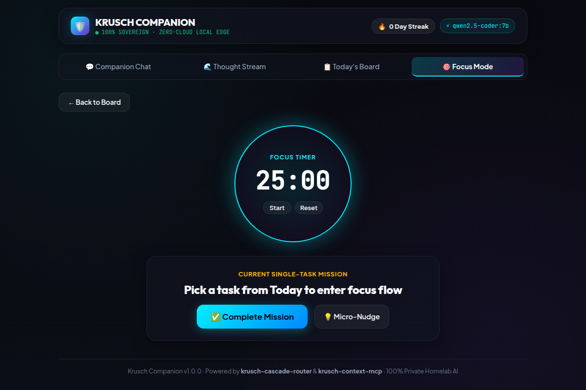

<p align="center">
  <h1 align="center">🛡️ Krusch Companion</h1>
  <p align="center">
    <strong>Sovereign Personal AI & Executive Operating System</strong><br>
    <em>A 100% private, local-first co-pilot for ADHD task triage, prioritized daily focus, and durable working memory.</em>
  </p>
</p>

<p align="center">
  <a href="https://github.com/kruschdev/krusch-companion/blob/main/LICENSE"></a>
  
  <a href="https://github.com/kruschdev/krusch-cascade-router"></a>
  <a href="https://github.com/kruschdev/krusch-context-mcp"></a>
  
  
</p>

---

## 💡 What It Does For You

**Krusch Companion** is a local-first personal assistant and executive operating system designed to overcome executive dysfunction, mental clutter, and ADHD overwhelm. Instead of sending your thoughts to centralized cloud data centers, Companion processes your voice notes, tasks, and habits entirely on your own home hardware.

### 🔄 The Daily Loop

```
  ┌─────────────────┐       ┌─────────────────┐       ┌─────────────────┐       ┌─────────────────┐
  │ 1. Chaos Dump   │  ──►  │ 2. Priority     │  ──►  │ 3. Focus Mode   │  ──►  │ 4. Evening      │
  │ Unstructured    │       │    Board        │       │ Single-Task     │       │    Reflection   │
  │ voice or text   │       │ 5-tier triage   │       │ Ambient timer   │       │ Wins & habits   │
  └─────────────────┘       └─────────────────┘       └─────────────────┘       └─────────────────┘
```

1. **Chaos Dump (Capture)**: Speak into the microphone or paste an unstructured stream-of-consciousness mental dump.
2. **5-Tier Triage (Organize)**: An edge LLM cleans cognitive noise, extracts actionable commitments, ranks them against a 5-tier priority framework, and isolates durable life facts into working memory.
3. **Today's Board (Execute)**: Tactile daily board highlighting the single most critical task, with gamified checkmarks and streak tracking.
4. **Focus Mode (Initiation)**: Fullscreen distraction-free timer with AI micro-nudges (`"Just do 3 minutes"`) to break task paralysis.
5. **Coach Briefings & Reflection (Review)**: Proactive morning alignment and evening wins wind-down.

### 🎯 Example Workflows

* **Voice/Text Chaos Dump**:
  > *"I need to send the updated invoice to Alex, fix the door latch before tonight, schedule a dentist checkup for next Tuesday, and I kept forgetting to stretch today."*
  > 
  > ➜ **Extracted into Tasks**:
  > 1. `Send updated invoice to Alex` (Tier 5: Work & Mastery)
  > 2. `Fix door latch before tonight` (Tier 4: Health & Self / Environment)
  > 3. `Schedule dentist checkup for Tuesday` (Tier 4: Health & Self)
  > 
  > ➜ **Saved to Working Memory**: `Remember to take stretching breaks during desk work` (Category: `lesson`).

* **Working Memory with Fact Superseding**:
  > *"Remember that I stopped drinking caffeine after 2 PM."*
  > 
  > ➜ Persisted as an `invariant` in local SQLite. Any obsolete past coffee habits are cleanly marked `superseded_by`, preventing prompt contradiction on future turns.

---

## 🚫 What It Is NOT

To be completely honest about scope and capabilities:

* **Not a general-knowledge frontier chatbot**: The local 7B model (`qwen2.5-coder:7b`) excels at task extraction, summarization, triage, and conversation, but it is not a drop-in replacement for 70B+ models (Claude 3.5 Sonnet, GPT-4o) on broad encyclopedic trivia, complex code generation, or multi-step logic proofs.
* **Not a multi-user SaaS**: Companion is a single-user executive co-pilot designed for personal sovereignty. There are no multi-tenant logins or shared organization workspaces.
* **Not zero-setup**: It requires running a local LLM runtime ([Ollama](https://ollama.com/)) on your machine or home server.

---

## 🖥️ User Interface Tour

The frontend is an installable Progressive Web App (PWA) built with React 19, Vite, and dark glassmorphism styling compliant with Apple HIG touch targets.

| 💬 Companion Chat | 🌪️ Chaos Dump |
|:---:|:---:|
|  |  |
| *Real-time L0/L1/L2 routing badges, morning focus briefings, and fast local chat.* | *Live HTML5 microphone waveform visualizer and stream-of-consciousness text input.* |

| 📋 Today's Board | 🎯 Focus Mode |
|:---:|:---:|
|  |  |
| *5-tier priority framework, gamified completion points, and streak counter.* | *Distraction-free single-task execution with ambient timer ring and hotkeys.* |

---

## 🚀 Quickstart

Krusch Companion supports two operating modes:
* **Option A: 100% Sovereign Local-First (Default)**: Uses local Ollama on your machine or home server. Zero network egress.
* **Option B: Zero-GPU Cloud Connector (OpenRouter)**: For laptops, cloud VPS, or devices without a discrete GPU. Uses [OpenRouter](https://openrouter.ai/) for inference with **Zero Data Retention** (`data_collection: "deny"`). Your database and working memory still remain 100% local in SQLite.

### Prerequisites

#### If running Option A (Local Ollama):
1. **Node.js**: `v22.0.0+`
2. **Local LLM Runtime**: [Ollama](https://ollama.com/) running locally:
   ```bash
   ollama pull qwen2.5-coder:7b
   ```
3. **Hardware Expectations**:
   * **GPU (Recommended)**: ~6–8 GB VRAM (RTX 2080 Ti, RTX 3060, Apple Silicon). ~30–50 tokens/sec.
   * **CPU (Usable)**: ~16 GB system RAM. ~5–10 tokens/sec.

#### If running Option B (OpenRouter Zero-GPU):
1. **Node.js**: `v22.0.0+`
2. **OpenRouter API Key**: Obtain from [openrouter.ai](https://openrouter.ai/keys). (Works with free or cheap models like `qwen/qwen-2.5-7b-instruct` or `meta-llama/llama-3.1-8b-instruct:free`).
3. **No GPU or Ollama required**! Runs on any low-power device.

### 📦 Ecosystem & Monorepo Dependencies

> [!NOTE]
> Krusch Companion is part of the Krusch homelab ecosystem. It references sibling packages via local file paths in `package.json`:
> - `@krusch/toolkit` (at `../../lib`)
> - `krusch-cascade-router` (at `../krusch-cascade-router`)

To run Companion, ensure your directory layout matches the monorepo structure:

```
homelab/
├── lib/                         # Shared @krusch/toolkit utilities
└── projects/
    ├── krusch-cascade-router/   # Microsecond CPU Cascade Router
    └── krusch-companion/        # This repository
```

### Installation & Run

```bash
# 1. Clone within the homelab workspace
git clone https://github.com/kruschdev/krusch-companion.git
cd krusch-companion

# 2. Install backend and frontend dependencies
npm install
cd client && npm install && cd ..

# 3. Build the frontend client
cd client && npm run build && cd ..

# 4. Run automated tests (21 unit & integration tests)
npm test

# 5. Start the server
# Path A: Local Ollama (default)
npm start

# Path B: OpenRouter Zero-GPU Mode
OPENROUTER_API_KEY="sk-or-v1-..." LLM_PROVIDER="openrouter" npm start
```

Visit **`http://localhost:3004`** in your browser, or install it as a PWA on your mobile device (iOS Safari: *Share → Add to Home Screen*; Android Chrome: *Install App*).

---

## 🏛️ System Architecture

Krusch Companion is built around the **Krusch Cascade Router** and the **KruschContext Engine**:

```
                                 [ User Interaction ]
                        (Voice WebM / Text / Keyboard Hotkeys)
                                          │
                                          ▼
                      ┌───────────────────────────────────────┐
                      │     krusch-cascade-router (L0 Gate)   │
                      │       <15µs CPU Intent & Cost Gate    │
                      └───────────────────┬───────────────────┘
                                          │
         ┌────────────────────────────────┼────────────────────────────────┐
         ▼                                ▼                                ▼
   [ Tier 0: Direct ]             [ Tier 1: Edge Local ]          [ Tier 2: Deep Local ]
   - Safe AST Arithmetic (<15µs)   - Local 7B Ollama               - Local 14B Swarm
   - Direct Memory Persistence    - Sub-second daily chat,        - Complex life planning,
   - Zero LLM Token Cost ($0.00)     triage, morning briefing        deep chaos dump synthesis
         │                                │                                │
         └────────────────────────────────┴────────────────────────────────┘
                                          │
                                          ▼
                      ┌───────────────────────────────────────┐
                      │          KruschContext Engine         │
                      │  - Working Memory (5 Closed Taxonomies│
                      │  - Temporal Fact Superseding & Decay  │
                      │  - Knowledge Boundary Gate (Pruning)  │
                      │  - SQLite WAL (Atomic VACUUM Backups) │
                      └───────────────────────────────────────┘
                                          │ (Strictly Opt-in, default blocked)
                                          ▼
                      [ Tier 3: Sovereign Cloud Escalation ]
                      (User-permissioned frontier reasoning only)
```

### 1. Sub-15µs CPU Cascade Router
* **L0 Deterministic Heuristic**: Captures commands like `"Remember that my dentist is on Friday"` or evaluates math expressions on CPU in microseconds with zero token cost.
* **L1 Local Edge**: Dispatches daily conversational queries to local Ollama (`qwen2.5-coder:7b`) with sub-second response times.
* **L2 Compute Swarm**: Transparently escalates heavy, multi-paragraph prompts to local network compute nodes (e.g. dual-GPU servers on LAN) with automatic fallback hedging.
* **L3 Cloud Privacy Gate**: External cloud escalation is strictly disabled by default (`allowCloudEscalation: false`).

### 2. KruschContext Working Memory & Temporal Superseding
Unlike naive vector memory that hoards contradictory entries:
* **5-Category Closed Taxonomy**:
  * `decision`: Firm commitments or choices.
  * `invariant`: Non-negotiable rules, constraints, or health boundaries.
  * `bug`: Friction points, habits to break, or personal pitfalls.
  * `lesson`: Tactical insights or routines learned.
  * `blocker`: Active external dependencies or stressors.
* **Temporal Superseding (`MemoryInvalidationEngine`)**: When a habit changes, the outdated record is marked `superseded_by`, preserving lineage without corrupting current context.
* **30-Day Decay Review**: Stale facts older than 30 days are automatically surfaced for hygiene review.

### 3. Knowledge Boundary Gating
Injecting long-term personal context into mathematically or syntactically self-contained tasks (e.g. arithmetic, simple timers) can introduce cognitive interference (*"Memory Is Not Always Needed"*, arXiv: 2608.23982). Companion gates memory retrieval, suppressing irrelevant backstory when executing closed-world tasks.

### 4. Enterprise Hardening & Zero-Lock Backups
* **AST Recursive-Descent Evaluator**: Replaces dangerous `eval` and `Function` calls with a pure AST arithmetic tokenizer supporting powers, decimals, and parentheses while safely rejecting code injection and division-by-zero.
* **Prompt Injection Shield**: Integrated `sanitizeAgentMessage` from `@krusch/toolkit/trajectory-guard` filters ChatML breakouts, Llama tags, and prompt injection patterns (*arXiv: 2608.10218*).
* **Sovereign Backup API**: Creates zero-lock SQLite snapshots in milliseconds using `VACUUM INTO` (`POST /api/backup`).

---

## ⚖️ Why This Exists: The Big Tech Tradeoff

| Dimension | Meta Muse / xAI Grok / OpenAI Dot | **Krusch Companion** |
|:---|:---|:---|
| **Data Ownership** | Centralized cloud data centers | **100% Local SQLite WAL on your hardware** |
| **Privacy Policy** | Chats mined for training & profiling | **Zero telemetry; zero cloud exfiltration by default** |
| **Inference Cost** | $20+/month subscription or ad-tracking | **$0.00 / Zero-token cost** once local models are running |
| **Offline Operation** | ❌ Fails without active internet connection | ✅ **Fully operational offline on local network** |
| **Task Routing** | Monolithic cloud roundtrips for all queries | **Cascade Router**: L0 Heuristic (<15µs) + L1 7B Edge + L2 14B Swarm |
| **Context Hygiene** | Unbounded vector RAG (prone to hallucinations) | **KruschContext**: 5 closed taxonomies + temporal superseding |
| **Reasoning Depth** | Frontier models (70B–400B cloud parameters) | **Local 7B/14B models** (optimized for triage, not frontier research) |
| **Executive Function**| Conversational chitchat and journaling | **Chaos Dump Engine**: Rambling speech triaged into 5-tier board |

---

## 🛡️ Privacy Deep-Dive: Local Ollama vs. OpenRouter

For most developers and privacy-conscious users, **OpenRouter is the most practical entry point** because running local 24/7 GPU hardware involves real operational overhead. However, switching from local inference to an API proxy introduces architectural differences that every privacy-minded user should understand.

### Comparative Threat Model

| Dimension | Option A: Local Ollama (Sovereign Default) | Option B: OpenRouter Cloud Connector |
|:---|:---|:---|
| **Hardware Barrier** | Requires 6–8 GB VRAM or 16 GB system RAM | **Zero GPU required** (MacBook Air, Raspberry Pi, VPS) |
| **Physical Perimeter**| 100% on `localhost` (`127.0.0.1`) or LAN | Ephemeral prompt text travels over TLS to OpenRouter |
| **Database & History**| **100% Local SQLite WAL** (`data/companion.db`) | **100% Local SQLite WAL** (database is never uploaded) |
| **Long-term Memory** | Stays on local disk | Stays on local disk |
| **L0 Heuristics (Math)**| Evaluated on local CPU in <15µs | Evaluated on local CPU in <15µs (never hits the network) |
| **Intermediary Trust** | None (self-hosted bare metal) | OpenRouter proxy + Upstream Model Provider |
| **Model Training Risk**| Physically impossible (weights run read-only) | Prevented via enforced `provider: { data_collection: "deny" }` |
| **Logging / Retention**| Zero external logs | Ephemeral transit; upstream hosts may retain 30-day abuse logs |

### The 5 Key Privacy Considerations

1. **Transit vs. Storage**:
   * **What never leaves your machine**: Your task lists, 5-tier priority board, completed task timestamps, streak counts, and KruschContext memory store stay **strictly on your local drive**.
   * **What travels in transit**: During an active turn, only the prompt text and immediate session context travel over TLS to OpenRouter for inference.
2. **The Intimate Nature of Executive / ADHD Data**:
   * An executive co-pilot is uniquely personal. Stream-of-consciousness Chaos Dumps often mention medical prescriptions (*"refill Adderall"*), therapy sessions, relationship friction, or sensitive financial notes.
   * If you are dumping highly confidential personal or medical data, **Option A (Local Ollama)** guarantees that not a single byte leaves your physical machine.
3. **The Two-Hop Trust Chain**:
   * Calling OpenRouter involves two hops: `[Your Companion] ──► [OpenRouter Proxy] ──► [Upstream Host (e.g. Together, DeepInfra, Fireworks, Azure)]`.
   * OpenRouter sees the plaintext request to count billing tokens, and forwards it to the model host.
4. **Enforced Zero Data Retention (`data_collection: "deny"`)**:
   * Krusch Companion automatically injects `provider: { data_collection: "deny" }` on every OpenRouter request. This parameter instructs OpenRouter to **strictly reject upstream providers that log prompts for model training**.
5. **Paid Endpoints vs. Free Endpoints**:
   * **Paid models** (such as `qwen/qwen-2.5-7b-instruct` at pennies per month) operate under commercial API privacy protections.
   * **Free models** (endpoints with the `:free` suffix) often explicitly trade free compute in exchange for allowing upstream providers to log prompts for safety tuning.
   * **Recommendation**: If using OpenRouter, stick to paid models and keep `OPENROUTER_ZDR=true`. For sensitive journaling, use **Hybrid Mode** or switch to local Ollama.

---

## ⚙️ Configuration (`config.json`)

The server configuration is located in `config.json` at the project root (and overridable via environment variables):

| Key | Default | Environment Var | Description |
|:---|:---|:---|:---|
| `app.port` | `3004` | `PORT` | Local port for Express API server and static client. |
| `app.host` | `"0.0.0.0"` | `HOST` | Host binding (`0.0.0.0` allows LAN access from phone/laptop). |
| `cascade.provider` | `"ollama"` | `LLM_PROVIDER` | Active LLM driver: `"ollama"` (local GPU), `"openrouter"` (zero-GPU cloud), or `"hybrid"`. |
| `cascade.allowCloudEscalation` | `false` | `ALLOW_CLOUD_ESCALATION` | When `false`, requests never leave local hardware. If `true` or `"hybrid"`, falls back to OpenRouter if Ollama fails. |
| `cascade.openrouterApiKey` | `""` | `OPENROUTER_API_KEY` | OpenRouter API key for zero-GPU mode or cloud fallback. |
| `cascade.openrouterModel` | `"qwen/qwen-2.5-7b-instruct"` | `OPENROUTER_MODEL` | Default model on OpenRouter (e.g. `meta-llama/llama-3.1-8b-instruct:free`). |
| `cascade.openrouterZeroDataRetention`| `true` | `OPENROUTER_ZDR` | **Privacy Shield**: Injects `provider: { data_collection: "deny" }` to prevent model training and prompt retention. |
| `cascade.l0HeuristicEnabled` | `true` | — | Enables sub-15µs CPU routing for math and direct memory storage (always local). |
| `cascade.edgeModel` | `"qwen2.5-coder:7b"` | `EDGE_MODEL` | Name of local Ollama model for fast daily tasks. |
| `cascade.swarmModel` | `"qwen2.5-coder:14b"`| `SWARM_MODEL` | Name of compute server model for deep reasoning. |
| `cascade.ollamaUrl` | `"http://127.0.0.1:11434"` | `OLLAMA_HOST` | URL of local Ollama instance. |
| `cascade.swarmUrl` | `"http://100.106.193.66:8000/v1"` | `SWARM_VLLM_URL` | URL of local network compute node (e.g. Tailscale IP). |
| `db.path` | `"./data/companion.db"` | `DB_PATH` | Path to SQLite WAL database file. |
| `context.decayDays` | `30` | `CONTEXT_DECAY_DAYS` | Age threshold in days before memories are flagged for decay review. |

> ### 🔒 OpenRouter Privacy & Sovereignty Guarantee
> When operating in OpenRouter mode:
> 1. **Zero Data Retention Enforced**: Krusch Companion transmits `provider: { data_collection: "deny" }` on every request, instructing OpenRouter to route exclusively to providers that do not log prompts or train on user inputs.
> 2. **Sovereign Local Storage**: Only the prompt for the active turn travels over TLS to OpenRouter. **100% of your persistent tasks, 5-tier boards, streak counts, and KruschContext working memory remain stored exclusively in local SQLite on your own drive.**
> 3. **L0 Direct Heuristic Remains 100% Local**: Deterministic arithmetic and direct memory parsing continue running on your local CPU in <15µs with zero network calls.

---

## 📡 Complete REST API Reference

| Method | Endpoint | Description |
|:---|:---|:---|
| `GET` | `/api/health` | Service status, connected local models, and privacy gate configuration. |
| `GET` | `/api/priorities` | Retrieves the 5-tier priority framework definitions and colors. |
| `GET` | `/api/tasks` | Retrieves tasks for date (`?date=YYYY-MM-DD`, defaults to today). |
| `POST` | `/api/tasks` | Creates a new task (`{ title, priority_id, notes, recurring, energy_level, date }`). |
| `PATCH` | `/api/tasks/:id/complete` | Toggles task completion and updates gamification points. |
| `DELETE`| `/api/tasks/:id` | Deletes a task by ID. |
| `GET` | `/api/streak` | Retrieves continuous task completion streak data. |
| `GET` | `/api/gamify/today` | Retrieves today's gamification points and opt-in status. |
| `POST` | `/api/gamify/opt-in` | Updates gamification opt-in status (`{ optedIn: boolean }`). |
| `POST` | `/api/companion/chat` | Main conversational endpoint routed via Cascade Router (`{ prompt, history, sessionId }`). |
| `POST` | `/api/companion/dump` | Ingests unformatted Chaos Dump text and triages into 5-tier tasks and memories. |
| `POST` | `/api/companion/voice` | Accepts multipart `audio` (WebM/WAV) -> Whisper STT -> Chaos Dump pipeline. |
| `GET` | `/api/coach/focus` | Retrieves today's active morning focus briefing. |
| `POST` | `/api/coach/focus` | Synthesizes a new morning focus briefing from tasks and working memory. |
| `POST` | `/api/coach/nudge` | Generates a 1-sentence ADHD micro-nudge for the current task. |
| `POST` | `/api/coach/reflect` | Synthesizes an evening reflection celebrating wins. |
| `GET` | `/api/context` | Retrieves active working memory nuggets and compiled state briefing (`?category=...`). |
| `POST` | `/api/context` | Persists a new memory nugget (`{ category, content, key, confidence }`). |
| `POST` | `/api/context/:id/supersede`| Invalidates an old memory record and links an updated fact (`{ newContent, reason }`). |
| `GET` | `/api/context/decay` | Lists memories older than N days (`?days=30`) for hygiene review. |
| `POST` | `/api/backup` | Creates an atomic zero-lock SQLite backup snapshot via `VACUUM INTO`. |
| `GET` | `/api/system/integrity` | Executes SQLite `PRAGMA integrity_check`. |

---

## 🐳 Docker Deployment

A multi-stage `Dockerfile` and `docker-compose.yml` are provided for home server deployment:

```bash
# Start containerized service in background
docker compose up -d

# View live container logs
docker compose logs -f

# Check container health
docker compose ps
```

---

## 🔧 Troubleshooting

| Symptom | Probable Cause | Resolution |
|:---|:---|:---|
| `fetch failed: ECONNREFUSED 127.0.0.1:11434` | Ollama is not running. | Run `ollama serve` or ensure the Ollama system service is active. |
| `Ollama error: model 'qwen2.5-coder:7b' not found` | Recommended model has not been pulled. | Execute `ollama pull qwen2.5-coder:7b`. |
| `Cannot find module '@krusch/toolkit'` | Monorepo layout path mismatch. | Ensure sibling directories exist (`../../lib` and `../krusch-cascade-router`). |
| `No audible speech detected` on voice upload | Microphone muted or Whisper server down. | Verify microphone permissions in browser or check Whisper service on port 9000. |
| Tasks not persisting across container restarts | Docker volume not mounted. | Ensure `./data` is mounted to `/app/data` in `docker-compose.yml`. |

---

## 📌 Project Status & Known Limitations

* **Current Stage**: Active daily driver in the Krusch homelab fleet. Single-user architecture; code is tightly coupled to the `@krusch/toolkit` and `krusch-cascade-router` monorepo layout.
* **Single User**: No authentication or multi-tenant user segregation out of the box (intended for private home networks or Tailscale mesh).
* **Hardware Sensitivity**: Speech-to-text and LLM inference response times depend directly on host GPU/CPU capabilities.

---

## 🔗 Related Projects

* [`krusch-cascade-router`](https://github.com/kruschdev/krusch-cascade-router): Sub-15µs CPU routing substrate with AST arithmetic evaluation and fallback hedging.
* [`krusch-context-mcp`](https://github.com/kruschdev/krusch-context-mcp): Model Context Protocol server providing working memory, invariant steering, and fact superseding.
* [`first-things-first`](https://github.com/kruschdev/first-things-first): The ADHD personal assistant platform that originated the 5-tier priority framework and Chaos Dump workflow.

---

## 📄 License

MIT © [kruschdev](https://github.com/kruschdev). Part of the Krusch Homelab Sovereign AI Ecosystem.
