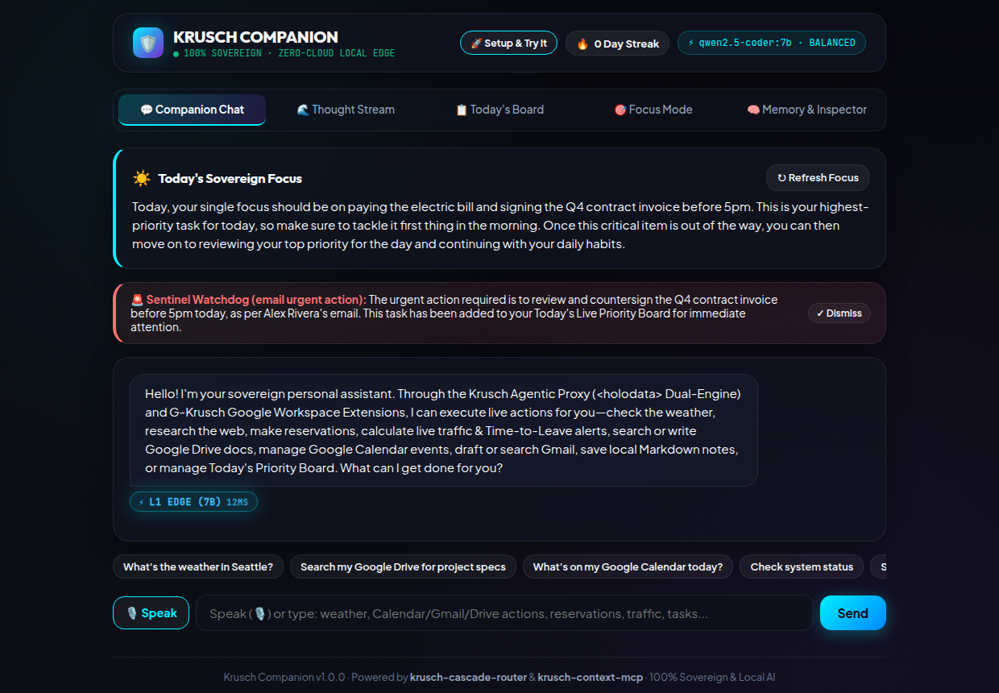
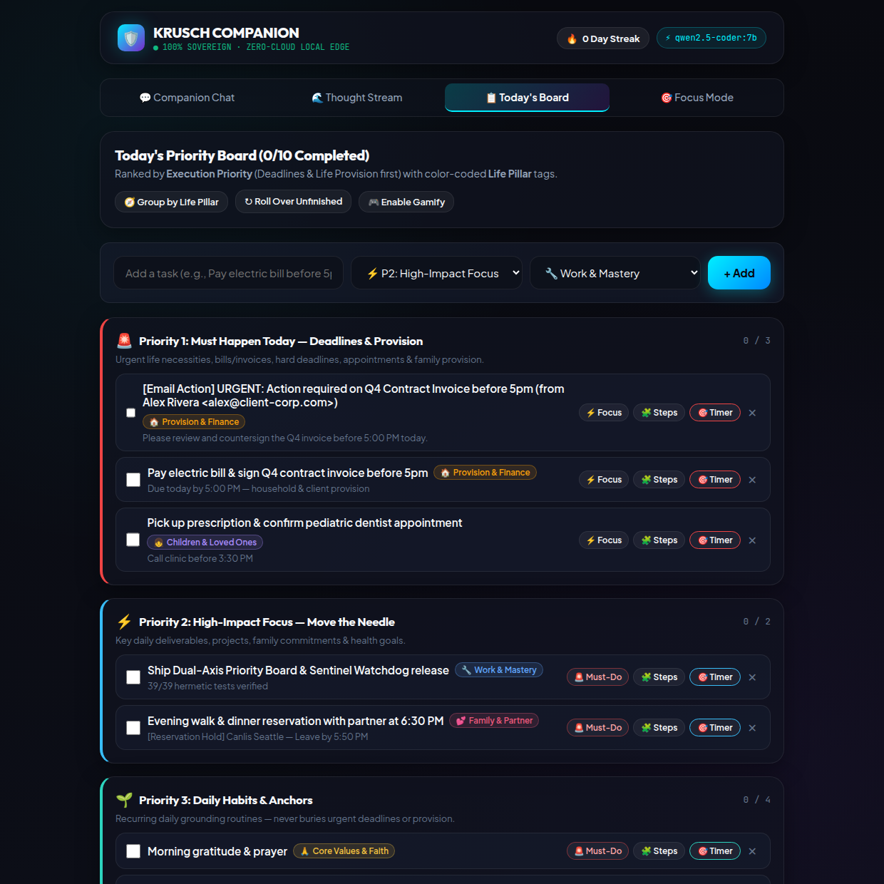
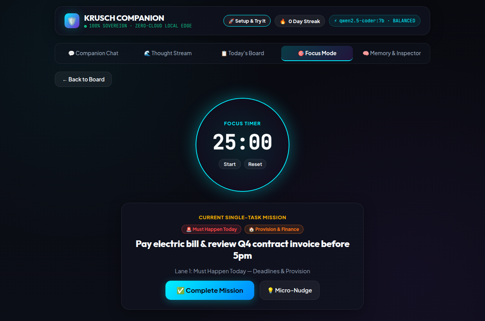

<p align="center">
  <h1 align="center">🛡️ Krusch Companion</h1>
  <p align="center">
    <strong>Sovereign Personal AI Assistant & Daily Companion</strong><br>
    <em>A 100% private, local-first companion (like Dot or Grok) for voice thought capture, prioritized daily focus, and durable working memory.</em>
  </p>
</p>

<p align="center">
  <a href="https://github.com/kruschdev/krusch-companion/blob/main/LICENSE"></a>
  
  <a href="https://github.com/kruschdev/krusch-cascade-router"></a>
  <a href="https://github.com/kruschdev/krusch-context-mcp"></a>
  <a href="https://github.com/kruschdev/krusch-agentic-mcp"></a>
  <a href="https://github.com/kruschdev/G-krusch"></a>
  <a href="https://github.com/kruschdev/krusch-companion/actions/workflows/ci.yml"></a>
  
</p>

---

## 💡 What It Does For You

**Krusch Companion** is a sovereign, local-first personal AI assistant and daily companion—a 100% private, user-owned alternative to **OpenClaw / Grokbot**, **Meta Muse**, or **OpenAI Dot**. Instead of surrendering your personal thoughts, daily schedule, and life notes to centralized cloud data centers, Companion runs on your own hardware—turning raw voice streams into clear daily priorities via a **Dual-Axis Priority Board (`Execution Priority Lanes 1–4` × `6 Life Pillar Tags`)**, executing **14 live external APIs, concierge reservations, live traffic & Time-to-Leave alerts, Google Workspace extensions, and multi-step personal assistant actions** via the **Krusch Agentic Proxy (`<holodata>` Dual-Engine)**, running a **Multi-Channel Zero-Token Proactive Sentinel Watchdog Daemon** that polls **Gmail, Google Calendar, and Live Route Traffic** on CPU and wakes the LLM only when an actionable event occurs, maintaining durable working memory across conversations, and providing supportive morning briefings and evening reflections.

### 🔄 The Daily Loop

```
  ┌─────────────────┐       ┌─────────────────┐       ┌─────────────────┐       ┌─────────────────┐
  │ 1. Thought      │  ──►  │ 2. Dual-Axis    │  ──►  │ 3. Agentic      │  ──►  │ 4. Focus &      │
  │    Stream       │       │    Board        │       │    Proxy (<holo>│       │    Reflection   │
  │ Voice or text   │       │ 4 lanes × 6 tags│       │ 14 live APIs    │       │ Timer & wins    │
  └─────────────────┘       └─────────────────┘       └─────────────────┘       └─────────────────┘
```

1. **Thought Stream (Capture)**: Speak into the microphone or paste an unfiltered stream-of-consciousness thought stream.
2. **Dual-Axis Triage (Organize)**: Traditional single-tier boards suffer from the *"Priority Paradox"*—even though *Core Values & Faith* or *Family* are your highest macro values, real-life responsibilities that provide for your family (paying the electric bill before 5pm, shipping a client deliverable, or fixing a broken lock) cannot sit at the bottom of the board underneath non-urgent daily habits. Companion resolves this by classifying every task across **two orthogonal axes**:
   - **Axis 1 — Execution Priority Lanes (Board Order)**:
     1. **`🚨 Must Happen Today — Deadlines & Provision`**: Time-sensitive deadlines, bills, client deliverables, appointments, and urgent life necessities that keep life running.
     2. **`⚡ High-Impact Focus — Move the Needle`**: Important daily work, family commitments, and meaningful progress.
     3. **`🌱 Daily Habits & Anchors`**: Recurring daily anchors (prayer/reflection, hydration, reading, stretching) that keep you grounded without burying urgent deadlines.
     4. **`📥 Backlog — When Time Permits`**: Low-urgency ideas and someday tasks.
   - **Axis 2 — Life Pillar Tags (Color-Coded Badges)**: `🙏 Core Values & Faith`, `💕 Family & Partner`, `👧 Children & Loved Ones`, `💪 Health & Self`, `🔧 Work & Mastery`, and `🏠 Provision & Finance`.
3. **Today's Board & Lifecycle (Execute)**: Tactile daily board grouped by **Execution Priority** (with a 1-click toggle to group by **Life Pillar**), 1-click **`🚨 Must-Do`** promotion on any task card, automatic daily recurring habit seeding, 1-click **"↻ Roll Over Unfinished"** task migration from prior days, 1-click **"🧩 Steps"** task decomposition, gamified checkmarks, and streak tracking.
4. **Agentic Action Proxy & L0 Commands (Act)**:
   - **Instant `<15µs` L0 CPU Commands (`$0.00` Token Cost)**: `Add task`, `Prioritize task / Make task urgent`, `Complete task`, `Delete task`, `Show my tasks`, `Roll over unfinished tasks`, `Break down task into steps`, `Instead of X, remember that Y`, plus safe AST arithmetic.
   - **14-Tool `<holodata>` Dual-Engine Agentic Proxy + G-Krusch Google Workspace Extensions**: Enables local 7B/14B models (or OpenRouter 32B/72B specialists) to execute real APIs and multi-step chains with automatic upstream-to-downstream data piping.
5. **Focus Mode & Coach Briefings (Deep Work & Review)**: Fullscreen distraction-free timer with ambient progress ring, AI micro-nudges (`"Just do 3 minutes"`), morning focus alignment, and evening wins reflection.

---

## ⚡ The 14-Tool Agentic Proxy (`<holodata>` Dual-Engine) & G-Krusch Workspace

Standard 7B/14B local models often struggle with deeply nested OpenAI JSON tool schemas when 10+ tools are injected into the prompt at once. Krusch Companion solves this by embedding the **`<holodata>` Dual-Engine Cognitive Blueprint** (adapted from [`krusch-agentic-mcp`](https://github.com/kruschdev/krusch-agentic-mcp)):
1. **Intent-Scoped Tool Pruning (`<250` tokens)**: [`detectAgenticIntent()`](src/agent/agentic-proxy.js) prunes the tool catalog down to only the 1–3 tools relevant to the user's request before calling the LLM.
2. **Unified `<holodata>` Thinker + Flat Tool Array**: The model first reasons through parameter constraints inside `<holodata>...</holodata>` XML tags and then emits a flat JSON tool array (`[{"name": "...", "arguments": {...}}]`).
3. **Upstream-to-Downstream Live Data Piping**: When chaining multiple tools in one turn (e.g., `get_weather` ➔ `save_note` or `gkrusch_drive` ➔ `gkrusch_gmail`), [`executeAgenticProxyTurn()`](src/agent/agentic-proxy.js) automatically pipes live upstream API outputs directly into downstream notes, push notifications, Google Drive docs, or Gmail drafts.
4. **Deterministic Offline Fallback**: Even if your local LLM or Google OAuth is temporarily offline, [`inferFallbackToolCalls()`](src/agent/agentic-proxy.js) and sovereign local fallbacks ensure tasks, notes, and drafts are never lost.

### 🛠️ Complete 14-Tool Capability Matrix

| Category | Tool Name | What It Accomplishes | Example Natural-Language Prompt |
| :--- | :--- | :--- | :--- |
| **🍽️ Concierge & Reservations** | `concierge_reservation` | Looks up live venue details (address, phone, website, hours, email via OpenStreetMap), generates pre-filled 1-click **OpenTable**, **Resy**, and **Google Maps** booking links, calculates live traffic & Leave-By time, drafts/sends a concierge reservation request via **G-Krusch Gmail**, and places a hold on Google Calendar & Today's Board. | *"Make a reservation at Canlis Seattle for 4 people on Friday at 7pm"* |
| **🚗 Traffic & Time-to-Leave** | `commute_departure_check` | Calculates driving distance, live/estimated traffic delay (Google Maps Directions `duration_in_traffic` + OSRM/OpenStreetMap zero-key fallback), and exact **"Leave By `HH:MM`"** departure warnings so you leave earlier when there's traffic. | *"When do I need to leave for my 6pm dinner in Bellevue and how is traffic?"* |
| **☁️ Google Drive & Docs** | `gkrusch_drive` | Hybrid semantic + FTS5 BM25 RAG search across Google Drive, Google Docs Markdown export, Drive file creation (`G-Krusch/output/`), and `agent.md` cloud steering (with automatic local `data/notes/` mirror). | *"Search my Google Drive for the Q4 Architecture Spec"* |
| **📅 Google Calendar** | `gkrusch_calendar` | Lists upcoming Google Calendar events or schedules new calendar meetings/appointments—automatically computing travel time, traffic delay, and Leave-By alerts for any event with a `location`. | *"Schedule a meeting on Google Calendar titled Architecture Sync at 2026-10-14T15:00:00"* |
| **✉️ Gmail Extension** | `gkrusch_gmail` | Searches Gmail messages (`from:`, `is:unread`), creates RFC-2822 MIME drafts in Gmail, or sends emails (with local `data/notes/email-draft-*.md` fallback). | *"Draft an email to team@krusch.dev about the Q4 Spec"* |
| **🌤️ Live Weather** | `get_weather` | Live geocoding + current temperature, wind speed, precipitation probability, and daily highs/lows via Open-Meteo (zero API key required). | *"What's the weather in Seattle right now?"* |
| **🔎 Web Research** | `web_research` | Queries DuckDuckGo Instant Answer & Wikipedia REST summaries for factual lookups and topic briefs. | *"Research the history of the Pomodoro Technique"* |
| **📄 URL Digest** | `fetch_url_digest` | **SSRF-guarded** live web page reader—strips scripts/styles and extracts readable text while blocking localhost, LAN, and cloud metadata IPs. | *"Read and summarize https://example.com"* |
| **📝 Notes Write** | `save_note` | Creates or updates clean Markdown documents inside your sandboxed local vault (`data/notes/`). | *"Save a note titled Weekly Goals: Ship v2.0 & review priorities"* |
| **📂 Notes Read** | `list_notes` | Lists all saved Markdown notes in `data/notes/` or reads a specific note by title. | *"Show my saved notes"* |
| **🔔 Push Alerts** | `send_notification` | Dispatches real-time push notifications to your phone or desktop via `ntfy.sh` or a custom self-hosted webhook topic. | *"Send a push notification to my phone: Pick up groceries at 5pm"* |
| **🖥️ Host Telemetry** | `system_status` | Reports live host CPU load, RAM usage, uptime, SQLite WAL `PRAGMA integrity_check`, active memory count, and board completion streak. | *"Check system status and telemetry"* |
| **⚖️ Sovereign Law/Biz** | `sovereign_gateway_query` | Queries local **KruschLaw (`:8085`)** for statutory RAG / tenant defense or **KruschBiz (`:8086`)** for corporate contract graphs. | *"Search KruschLaw statutes for California security deposit return deadlines"* |
| **📋 Board & Memory** | `board_action` | Creates or completes tasks on Today's 5-Tier Priority Board or saves durable facts to Working Memory as part of a multi-step tool chain. | *"Check the weather in Seattle and add a task to go for a 3-mile run"* |

### 🚨 Multi-Channel Proactive Sentinel Watchdog Daemon (`$0.00` Polling ➔ Event-Driven LLM Wakeup)

Instead of burning LLM tokens polling for changes in a loop, [`src/services/sentinel-daemon.js`](src/services/sentinel-daemon.js) runs a lightweight background watchdog every 5 minutes across **3 monitored channels** at **`$0.00` / `0` LLM tokens**, waking the LLM **only** when an actionable anomaly occurs:
1. **✉️ Gmail Unread Actionable Triage ([`evaluateEmailTrigger`](src/services/sentinel-daemon.js))**: Polls `GET /api/gmail/messages?q=is:unread` via G-Krusch, discards marketing/newsletter noise (`unsubscribe`, `% off`, `daily digest`, `no-reply@`) on CPU at `0` tokens, and wakes the LLM **only** on reservation/booking updates (`email_reservation_or_schedule`) or urgent action items (`email_urgent_action`: invoices, contracts, deadlines, direct urgent requests)—while automatically staging an `[Email Action]` task on Today's Priority Board.
2. **📅 Google Calendar Conflict & Imminent Meeting Watchdog ([`evaluateCalendarAnomalies`](src/services/sentinel-daemon.js))**: Polls upcoming Google Calendar events and wakes the LLM on overlapping double-bookings (`calendar_conflict`) or meetings starting within $\le 15$ minutes (`calendar_starting_soon`).
3. **🚗 Live Route, Traffic & Departure Watchdog ([`evaluateSentinelTrigger`](src/services/sentinel-daemon.js))**: Polls location-tagged events using Google Maps Traffic / OSRM and wakes the LLM **only** on sudden traffic spikes (`+5m` surge), accidents/road closures (`accident_or_incident`), heavy congestion (`+8m` delay), or imminent departure windows ($\le 18\text{m}$ before Leave-By time).
4. **Proactive Advisory Delivery**: When any channel trips its gate, the daemon wakes the LLM to synthesize a 1–2 sentence advisory, persists it to `sentinel_alerts`, pushes it via `ntfy.sh`, and surfaces it in the Companion UI (`GET /api/sentinel/status`, `POST /api/sentinel/tick`, `POST /api/sentinel/ack/:id`).

### 🎯 Example Multi-Step Workflows

* **Google Workspace Chain (`gkrusch_drive` ➔ `gkrusch_calendar` ➔ `gkrusch_gmail`)**:
  > *"Search my Google Drive for Q4 Architecture Spec, schedule an Architecture Sync on my Google Calendar, and draft an email to team@krusch.dev with the summary."*
  > ➜ **Tool 1 (`gkrusch_drive`)**: Runs hybrid semantic + BM25 search across your indexed Google Drive workspace.
  > ➜ **Tool 2 (`gkrusch_calendar`)**: Creates the event on Google Calendar (or falls back to Today's Priority Board if offline).
  > ➜ **Tool 3 (`gkrusch_gmail`)**: Automatically pipes the Google Drive RAG summary into a Gmail draft (with local Markdown mirror in `data/notes/`).

* **Weather + Note + Push Notification + Priority Board Chain**:
  > *"What is the weather in Seattle right now, save a note titled Run Forecast, and add a task to go for a 20-minute walk?"*
  > ➜ **Tool 1 (`get_weather`)**: Queries live Open-Meteo API (`60.8°F / 16°C — Overcast ☁️, Wind 1.9 mph, Precip 10%`).
  > ➜ **Tool 2 (`save_note`)**: Automatically pipes the live weather forecast into `data/notes/run-forecast.md`.
  > ➜ **Tool 3 (`board_action`)**: Creates **[Tier 4: Health & Self 💪] Go for a 20-minute walk** on Today's Board.

* **Voice/Text Thought Stream (Dual-Axis Triage)**:
  > *"I need to pay the electric bill before 5pm, send the updated invoice to Alex, fix the door latch before tonight, and I kept forgetting to stretch today."*
  > ➜ **Extracted onto Today's Dual-Axis Board**:
  > 1. `Pay the electric bill before 5pm` — **`🚨 Must Happen Today — Deadlines & Provision`** · Tag: `🏠 Provision & Finance`
  > 2. `Send updated invoice to Alex` — **`🚨 Must Happen Today — Deadlines & Provision`** · Tag: `🔧 Work & Mastery`
  > 3. `Fix door latch before tonight` — **`🚨 Must Happen Today — Deadlines & Provision`** · Tag: `🏠 Provision & Finance`
  > *(All three sit at the very top of Today's Board above non-urgent `🌱 Daily Habits & Anchors` like morning prayer or reading, while preserving their Life Pillar badges.)*
  > ➜ **Saved to Working Memory**: `Remember to take stretching breaks during desk work` (Category: `lesson`).

* **Instant L0 Task & Board Commands in Chat (`<15µs` CPU, `$0.00` LLM Cost)**:
  > *"Add task: Pay electric bill before 5pm"* ➜ Automatically inferred as **`🚨 Must Happen Today — Deadlines & Provision`** (`🏠 Provision & Finance`) and placed at the top of Today's Board.
  > *"Prioritize task: Quarterly review"* (or *"Make task quarterly review urgent"*) ➜ Promotes any existing task to **`🚨 Must Happen Today`** in `<15µs`.
  > *"Complete task: electric bill"* ➜ Marks the matching task completed on Today's Board and awards gamification points (`+20 pts` for Lane 1 Must-Do tasks).
  > *"Break down 'Prepare quarterly taxes' into steps"* ➜ Decomposes the goal into 3 bite-sized (5–15 min) subtasks on Today's Board.
  > *"Roll over unfinished tasks"* ➜ Moves incomplete tasks from prior days onto Today's Board without duplicating recurring habits.

* **Working Memory with Fact Superseding**:
  > *"Instead of espresso, remember that I switched to green tea after lunch."*
  > ➜ Persisted in local SQLite (`companion_context`). The obsolete coffee memory is atomically marked `superseded_by` with full lineage, preventing prompt contradiction on future turns.

---

## 🚫 What It Is NOT

To be completely honest about scope and capabilities:

* **Not a multi-user SaaS**: Companion is a single-user executive co-pilot designed for personal sovereignty. There are no multi-tenant logins or shared organization workspaces.
* **Not zero-setup**: It requires running a local LLM runtime ([Ollama](https://ollama.com/)) on your machine or home server, or setting an OpenRouter API key for zero-GPU mode.

---

## 🖥️ User Interface Tour

The frontend is an installable Progressive Web App (PWA) built with React 19, Vite, and dark glassmorphism styling compliant with Apple HIG touch targets.

| 💬 Companion Chat | 🌊 Thought Stream |
|:---:|:---:|
|  |  |
| *Real-time L0/L1/L2/L3 routing badges, expandable `<holodata>` Agentic Proxy traces, Sentinel Watchdog alerts, and morning focus briefings.* | *Live HTML5 microphone waveform visualizer and Dual-Axis stream-of-consciousness text triage.* |

| 📋 Today's Board | 🎯 Focus Mode |
|:---:|:---:|
|  |  |
| *Dual-Axis Priority Board (`Execution Priority Lanes 1–4` × `6 Life Pillar Badges`), 1-click `🚨 Must-Do` promotion, task rollover & step decomposition.* | *Distraction-free single-task execution with Dual-Axis badges, ambient timer ring, and hotkeys.* |

---

## 🚀 Quickstart (100% Standalone-Installable)

**Krusch Companion is completely self-contained** (`krusch-cascade-router` is installed directly from npm and `@krusch/toolkit` primitives are bundled inside [`src/toolkit/`](src/toolkit/)). You can clone and run this repository on any machine in three modes:

* **Option A — 100% Sovereign Local-First (Default)**: Uses local [Ollama](https://ollama.com/) (`qwen2.5-coder:7b`) on your machine or home server. Zero LLM network egress.
* **Option B — Zero-GPU Cloud Connector (OpenRouter 3-Specialist Cascade)**: For laptops, cloud VPS, or devices without a discrete GPU. Uses [OpenRouter](https://openrouter.ai/) with enforced **Zero Data Retention** (`provider: { data_collection: "deny" }`) and dynamically routes across 3 specialized frontier models (`qwen-2.5-coder-32b-instruct`, `qwen-2.5-72b-instruct`, and `deepseek-chat-v3-0324`). Your database, notes vault, and working memory still remain 100% local in SQLite.
* **Option C — Hermetic Zero-Dependency Evaluation Mode (`MOCK_LLM=1`)**: For CI pipelines or third-party evaluators who want to verify all 39 tests, deterministic L0 routing, `<holodata>` tool chains, and Sentinel Watchdog filters in **`<300ms`** without installing Ollama or providing an API key.

### 1. Prerequisites
* **Node.js**: `v22.0.0+` (includes native `fetch` and test runner)
* **Build Tools**: Standard C++ build tools (`build-essential` / Xcode CLI tools) if `better-sqlite3` compiles from source (prebuilt binaries are downloaded automatically on Linux/macOS/Windows x64 & ARM64).
* **LLM Backend (Choose One)**:
  * **Local Ollama (Option A)**: Install [Ollama](https://ollama.com/) and pull the edge model:
    ```bash
    ollama pull qwen2.5-coder:7b
    ```
  * **OpenRouter API Key (Option B)**: Obtain an API key from [openrouter.ai/keys](https://openrouter.ai/keys) (no GPU required).
  * **Hermetic Evaluator Mode (Option C)**: Set `MOCK_LLM=1` (no Ollama or API key required).

### 2. Installation & Build

```bash
# 1. Clone the repository
git clone https://github.com/kruschdev/krusch-companion.git
cd krusch-companion

# 2. Install backend and frontend dependencies
npm install
npm --prefix client install

# 3. Build the React 19 + Vite frontend bundle (served statically by Express on :3004)
npm --prefix client run build
```

### 3. Run the Automated Test Suite (`39/39` Tests)

```bash
# Instant Hermetic Verification (<300ms — zero GPU or API key required)
MOCK_LLM=1 npm test

# Or Full Live Integration Verification (against local Ollama on 127.0.0.1:11434)
npm test
```

### 4. Start the Server

```bash
# Mode A: Local Ollama (Default — http://localhost:3004)
npm start

# Mode B: OpenRouter Zero-GPU 3-Specialist Cascade Mode (with enforced ZDR)
OPENROUTER_API_KEY="sk-or-v1-..." LLM_PROVIDER="openrouter" npm start

# Mode C: Hermetic Evaluation Mode (no Ollama or API key required)
MOCK_LLM=1 npm start
```

Open **`http://localhost:3004`** in your browser, or install it as a PWA on mobile (iOS Safari: *Share → Add to Home Screen*; Android Chrome: *Install App*).

> [!TIP]
> **Optional Google Workspace Integration (`G-Krusch` on `:5446`)**: To enable live Google Drive Hybrid RAG, Google Docs export, Google Calendar event creation, and Gmail sending, run the companion [`G-krusch`](https://github.com/kruschdev/G-krusch) service on `http://127.0.0.1:5446`. Even if `G-krusch` is not running, **every tool in Krusch Companion degrades gracefully** by saving reservation holds, calendar entries, and RFC-2822 email drafts to your local `data/notes/` vault and Today's Priority Board.

---

## 🧪 Third-Party Evaluator Verification Guide

With the server running on `http://localhost:3004` (in Ollama, OpenRouter, or `MOCK_LLM=1` mode), you can verify every architectural subsystem directly from a terminal using `curl`:

### 1. Verify Health, Privacy Gate & Registered Tools
```bash
# Check service health, active LLM provider, and Zero-Data-Retention status
curl -s http://localhost:3004/api/health | jq .

# List all 14 registered <holodata> Agentic Proxy tools and schemas
curl -s http://localhost:3004/api/companion/tools | jq '{engine, count: (.tools | length), tools: [.tools[].name]}'
```

### 2. Verify Sub-15µs L0 CPU Routing & Dual-Axis Priority Board (`$0.00` Token Cost)
```bash
# Deterministic AST arithmetic evaluated on CPU in <15µs (tierUsed: "L0_heuristic")
curl -s -X POST http://localhost:3004/api/companion/chat \
  -H "Content-Type: application/json" \
  -d '{"prompt": "What is (144 / 12) ^ 2 + 15?"}' | jq '{reply, tierUsed, latencyMs, reason}'

# Natural-language L0 task creation: auto-classified into Lane 1 (Must Happen Today — Deadlines & Provision)
# with Life Pillar tag "Provision & Finance", sorting above recurring daily habits ($0.00 cost)
curl -s -X POST http://localhost:3004/api/companion/chat \
  -H "Content-Type: application/json" \
  -d '{"prompt": "Add task: Pay electric bill before 5pm"}' | jq '{reply, tierUsed, actionExecuted}'
```

### 3. Verify Concierge Reservations & Live Route Traffic (`Leave-By` Alerts)
```bash
# Execute concierge_reservation: looks up venue on OpenStreetMap, generates OpenTable/Resy/Maps links,
# computes travel time & Leave-By alert, creates email draft, and places a hold on Today's Board
curl -s -X POST http://localhost:3004/api/companion/action \
  -H "Content-Type: application/json" \
  -d '{
    "tool": "concierge_reservation",
    "arguments": {
      "venue": "Canlis Seattle",
      "partySize": 4,
      "dateTime": "2026-10-16T19:00:00",
      "notes": "Window table if available"
    }
  }' | jq .

# Execute commute_departure_check: computes route distance, traffic delay, and exact Leave-By time
curl -s -X POST http://localhost:3004/api/companion/action \
  -H "Content-Type: application/json" \
  -d '{
    "tool": "commute_departure_check",
    "arguments": {
      "destination": "Bellevue, WA",
      "origin": "Seattle, WA",
      "arrivalTime": "2026-10-16T18:00:00"
    }
  }' | jq .
```

### 4. Verify Multi-Channel Proactive Sentinel Watchdog (`$0.00` Polling ➔ Event-Driven LLM Wakeup)
```bash
# Simulate a 5-minute Sentinel Watchdog tick with:
#  - 1 promotional newsletter email (ignored on CPU at 0 tokens)
#  - 1 urgent contract invoice email (wakes LLM + stages [Email Action] task on Today's Board)
#  - 2 overlapping Google Calendar meetings (wakes LLM for double-booking conflict)
curl -s -X POST http://localhost:3004/api/sentinel/tick \
  -H "Content-Type: application/json" \
  -d '{
    "emails": [
      {
        "id": "eval-promo-1",
        "from": "Store Newsletter <no-reply@marketing.example.com>",
        "subject": "50% OFF Flash Sale Ends Tonight — Unsubscribe",
        "snippet": "Click to unsubscribe from our promotional digest."
      },
      {
        "id": "eval-urgent-2",
        "from": "Alex Rivera <alex@client-corp.com>",
        "subject": "URGENT: Action required on Q4 Contract Invoice before 5pm",
        "snippet": "Please sign and return the attached invoice before today deadline."
      }
    ],
    "calendarEvents": [
      {
        "id": "eval-cal-1",
        "summary": "Architecture Review",
        "start": "2026-10-16T14:00:00-07:00",
        "end": "2026-10-16T15:00:00-07:00"
      },
      {
        "id": "eval-cal-2",
        "summary": "Client Demo Call",
        "start": "2026-10-16T14:30:00-07:00",
        "end": "2026-10-16T15:30:00-07:00"
      }
    ]
  }' | jq '{llmCallsTriggered, triggeredAlerts: [.triggeredAlerts[] | {channel, triggerReason, eventSummary, message}]}'
```

### 5. Verify KruschContext Temporal Fact Superseding & Atomic SQLite Backup
```bash
# Store an initial memory fact, then supersede it with lineage tracking
curl -s -X POST http://localhost:3004/api/companion/chat \
  -H "Content-Type: application/json" \
  -d '{"prompt": "Remember that I drink espresso after lunch"}' | jq '{reply, tierUsed}'

curl -s -X POST http://localhost:3004/api/companion/chat \
  -H "Content-Type: application/json" \
  -d '{"prompt": "Instead of espresso, remember that I switched to green tea after lunch"}' | jq '{reply, tierUsed}'

# Trigger a zero-lock SQLite VACUUM INTO snapshot backup
curl -s -X POST http://localhost:3004/api/backup | jq .
```

---

## 🏛️ System Architecture & Repository Structure

Krusch Companion is built around four core engines: the **Krusch Cascade Router**, the **14-Tool `<holodata>` Dual-Engine Agentic Proxy**, the **Multi-Channel Proactive Sentinel Watchdog Daemon**, and the **KruschContext Working Memory Engine**:

```
                                 [ User Interaction ]
                        (Voice WebM / Text / Keyboard Hotkeys)
                                          │
                                          ▼
                      ┌───────────────────────────────────────┐
                      │     krusch-cascade-router (L0 Gate)   │
                      │       <15µs CPU Intent & Cost Gate    │
                      └───────────────────┬───────────────────┘
                                          │
         ┌────────────────────────────────┼────────────────────────────────┐
         ▼                                ▼                                ▼
   [ Tier 0: Direct CPU ]     [ <holodata> Agentic Proxy ]     [ Tier 1 / 2 / Cloud ]
   - Safe AST Arithmetic       - Intent-Scoped Tool Pruning     - Local: 7B Edge / 14B Swarm
   - Direct Task/Board/Memory  - 14 Live Tools + Chaining       - OpenRouter 3-Specialist
   - <15µs Latency ($0.00)     - Concierge, Traffic & G-Krusch    Dynamic Cascade (ZDR)
         │                                │                                │
         └────────────────────────────────┼────────────────────────────────┘
                                          ▲
                      ┌───────────────────┴───────────────────┐
                      │  Proactive Sentinel Watchdog Daemon   │
                      │  - 5-Min Zero-Token CPU Polling ($0)  │
                      │  - Gmail Unread Spam vs Action Filter │
                      │  - Calendar Conflict & 15m Alert Gate │
                      │  - Live Route Traffic Spike & Leave-By│
                      └───────────────────┬───────────────────┘
                                          │
                                          ▼
                      ┌───────────────────────────────────────┐
                      │          KruschContext Engine         │
                      │  - Working Memory (5 Closed Taxonomies│
                      │  - Temporal Fact Superseding & Decay  │
                      │  - Knowledge Boundary Gate (Pruning)  │
                      │  - SQLite WAL + data/notes/ Vault     │
                      └───────────────────────────────────────┘
```

### 📂 Repository Structure

```
krusch-companion/
├── src/
│   ├── server.js                  # Express API server, routes, and static PWA host (:3004)
│   ├── agent/
│   │   ├── agentic-proxy.js       # <holodata> Dual-Engine parser, tool pruner & data piper
│   │   └── tools.js               # 14 sandboxed tools (Concierge, Traffic, G-Krusch, Weather, etc.)
│   ├── services/
│   │   ├── sentinel-daemon.js     # Multi-Channel Sentinel Watchdog (Gmail, Calendar, Traffic)
│   │   ├── chaos-dump.js          # Thought Stream Dual-Axis triage & memory extraction
│   │   └── coach.js               # Morning briefings, focus micro-nudges & evening reflections
│   ├── router/
│   │   └── cascade-client.js      # L0 (<15µs) CPU router, Ollama & OpenRouter 3-Specialist cascade
│   ├── context/
│   │   └── index.js               # KruschContext 5-taxonomy store, superseding & boundary gate
│   ├── db/
│   │   └── index.js               # SQLite WAL Dual-Axis schema, recurring habit seeder & task rollover
│   └── toolkit/                   # Self-contained @krusch/toolkit modules (zero external path deps)
├── client/                        # React 19 + Vite dark glassmorphism Progressive Web App
└── tests/                         # 39 automated unit & integration tests across 5 test files
```

### 1. Sub-15µs CPU Cascade Router & Dynamic Specialist Routing
* **L0 Deterministic Heuristic (`<15µs` CPU, `$0.00` Cost)**: Captures commands like `"Add task: ..."`, `"Prioritize task: ..."`, `"Complete task: ..."`, `"Show my tasks"`, `"Roll over unfinished tasks"`, `"Instead of X, remember that Y"`, or evaluates math expressions on CPU in microseconds with zero token cost.
* **L1 Local Edge (`Ollama`)**: Dispatches daily conversational queries and `<holodata>` tool calls to local Ollama (`qwen2.5-coder:7b`) with sub-second response times.
* **L2 Compute Swarm (`vLLM` / `Ollama 14B`)**: Transparently escalates heavy, multi-paragraph prompts to local network compute nodes with automatic fallback hedging.
* **OpenRouter 3-Specialist Dynamic Cascade (Zero-GPU Mode)**: When `LLM_PROVIDER="openrouter"` (or hybrid escalation is enabled), [`selectOpenRouterSpecialistModel()`](src/router/cascade-client.js) inspects each turn and dynamically selects the optimal Zero-Data-Retention (`data_collection: "deny"`) specialist model:

| Specialist Role | Selected OpenRouter Model | Live ZDR Benchmark Latency (2-Tool / 3-Tool Chain) | `<holodata>` Accuracy |
| :--- | :--- | :---: | :---: |
| **🛠️ Tool Calling, `<holodata>` Proxy & JSON Triage** | `qwen/qwen-2.5-coder-32b-instruct` | **`444ms` / `403ms`** | **100%** |
| **💬 Daily Companion, Coaching & Morning Briefings** *(Default)* | `qwen/qwen-2.5-72b-instruct` | **`544ms` / `1135ms`** | **100%** |
| **🧠 Deep Multi-Step Reasoning & Architecture Analysis** | `deepseek/deepseek-chat-v3-0324` | **`1788ms` / `1314ms`** | **100%** |

### 2. KruschContext Working Memory & Temporal Superseding
Unlike naive vector memory that hoards contradictory entries:
* **5-Category Closed Taxonomy**:
  * `decision`: Firm commitments or choices.
  * `invariant`: Non-negotiable rules, constraints, or health boundaries.
  * `bug`: Friction points, habits to break, or personal pitfalls.
  * `lesson`: Tactical insights or routines learned.
  * `blocker`: Active external dependencies or stressors.
* **Temporal Superseding (`MemoryInvalidationEngine`)**: When a habit changes, the outdated record is marked `superseded_by`, preserving lineage without corrupting current context.
* **30-Day Decay Review**: Stale facts older than 30 days are automatically surfaced for hygiene review.

### 3. Knowledge Boundary Gating
Injecting long-term personal context into mathematically or syntactically self-contained tasks (e.g. arithmetic, simple timers) can introduce cognitive interference (*"Memory Is Not Always Needed"*, arXiv: 2608.23982). Companion gates memory retrieval, suppressing irrelevant backstory when executing closed-world tasks.

### 4. Enterprise Hardening, SSRF Shield & Zero-Lock Backups
* **AST Recursive-Descent Evaluator**: Replaces dangerous `eval` and `Function` calls with a pure AST arithmetic tokenizer supporting powers, decimals, and parentheses while safely rejecting code injection and division-by-zero.
* **SSRF Network Guard (`isSafeExternalUrl`)**: Blocks loopback (`127.0.0.1`, `localhost`), RFC1918 private LAN ranges, and cloud metadata IPs (`169.254.169.254`) on external URL digest requests.
* **Prompt Injection Shield**: Integrated `sanitizeAgentMessage` from `@krusch/toolkit/trajectory-guard` filters ChatML breakouts, Llama tags, and prompt injection patterns (*arXiv: 2608.10218*).
* **Sovereign Backup API**: Creates zero-lock SQLite snapshots in milliseconds using `VACUUM INTO` (`POST /api/backup`).

---

## ⚖️ Why This Exists: The Big Tech Tradeoff

| Dimension | OpenClaw / Grokbot / Meta Muse / OpenAI Dot | **Krusch Companion** |
|:---|:---|:---|
| **Data Ownership** | Centralized cloud data centers | **100% Local SQLite WAL & `data/notes/` on your hardware** |
| **Privacy Policy** | Chats mined for training & profiling | **Zero telemetry; enforced `data_collection: "deny"` in cloud mode** |
| **Inference Cost** | $20+/month subscription or ad-tracking | **$0.00 / Zero-token cost** on local Ollama (or pennies/mo via OpenRouter) |
| **Offline Operation** | ❌ Fails without active internet connection | ✅ **Fully operational offline on local network** |
| **Live Action & Tool Execution** | Cloud-locked proprietary plugins | **14-Tool `<holodata>` Agentic Proxy** (Concierge Reservations, Live Traffic & Time-to-Leave, Weather, Web, Notes, Alerts, Telemetry, Legal/Biz RAG) |
| **Proactive Background Monitoring** | Always-on cloud polling or none | **Multi-Channel Sentinel Watchdog Daemon** (`$0.00` CPU polling for Gmail, Calendar conflicts, and Traffic spikes; wakes LLM only on actionable anomalies) |
| **Google Workspace Integration** | Full cloud read access to your account | **Sovereign `G-Krusch` Bridge** (Drive Hybrid RAG, Docs, Calendar, Gmail + local offline fallbacks) |
| **Task Routing** | Monolithic cloud roundtrips for all queries | **Cascade Router**: L0 Heuristic (<15µs) + L1 Edge + L2/Specialist Cascade |
| **Context Hygiene** | Unbounded vector RAG (prone to hallucinations) | **KruschContext**: 5 closed taxonomies + temporal superseding |
| **Actionable Priority Triage**| Conversational chitchat and journaling | **Thought Stream Engine**: Rambling speech triaged into 5-tier board |

---

## 🛡️ Privacy Deep-Dive: Local Ollama vs. OpenRouter

For most developers and privacy-conscious users, **OpenRouter is the most practical entry point** because running local 24/7 GPU hardware involves real operational overhead. However, switching from local inference to an API proxy introduces architectural differences that every privacy-minded user should understand.

### Comparative Threat Model

| Dimension | Option A: Local Ollama (Sovereign Default) | Option B: OpenRouter Cloud Connector |
|:---|:---|:---|
| **Hardware Barrier** | Requires 6–8 GB VRAM or 16 GB system RAM | **Zero GPU required** (MacBook Air, Raspberry Pi, VPS) |
| **Physical Perimeter**| 100% on `localhost` (`127.0.0.1`) or LAN | Ephemeral prompt text travels over TLS to OpenRouter |
| **Database & History**| **100% Local SQLite WAL** (`data/companion.db`) | **100% Local SQLite WAL** (database is never uploaded) |
| **Long-term Memory** | Stays on local disk | Stays on local disk |
| **L0 Heuristics (Math/Tasks)**| Evaluated on local CPU in <15µs | Evaluated on local CPU in <15µs (never hits the network) |
| **Intermediary Trust** | None (self-hosted bare metal) | OpenRouter proxy + Upstream Model Provider |
| **Model Training Risk**| Physically impossible (weights run read-only) | Prevented via enforced `provider: { data_collection: "deny" }` |
| **Logging / Retention**| Zero external logs | Ephemeral transit; upstream hosts may retain 30-day abuse logs |

### The 5 Key Privacy Considerations

1. **Transit vs. Storage**:
   * **What never leaves your machine**: Your task lists, 5-tier priority board, completed task timestamps, streak counts, local Markdown vault (`data/notes/`), and KruschContext memory store stay **strictly on your local drive**.
   * **What travels in transit**: During an active turn, only the prompt text and immediate session context travel over TLS to OpenRouter for inference.
2. **The Intimate Nature of Personal Journaling & Daily Thoughts**:
   * A personal AI companion is uniquely intimate. Stream-of-consciousness Thought Streams often mention medical prescriptions (*"refill medication"*), therapy appointments, relationship friction, or sensitive financial notes.
   * If you are dumping highly confidential personal or medical data, **Option A (Local Ollama)** guarantees that not a single byte leaves your physical machine.
3. **The Two-Hop Trust Chain**:
   * Calling OpenRouter involves two hops: `[Your Companion] ──► [OpenRouter Proxy] ──► [Upstream Host (e.g. Together, DeepInfra, Fireworks, Azure)]`.
   * OpenRouter sees the plaintext request to count billing tokens, and forwards it to the model host.
4. **Enforced Zero Data Retention (`data_collection: "deny"`)**:
   * Krusch Companion automatically injects `provider: { data_collection: "deny" }` on every OpenRouter request. This parameter instructs OpenRouter to **strictly reject upstream providers that log prompts for model training**.
5. **Paid Endpoints vs. Free Endpoints**:
   * **Paid models** (such as `qwen/qwen-2.5-72b-instruct`, `qwen/qwen-2.5-coder-32b-instruct`, and `deepseek/deepseek-chat-v3-0324` at pennies per month) operate under commercial API privacy protections and support strict Zero Data Retention (`data_collection: "deny"`).
   * **Free models** (endpoints with the `:free` suffix) often explicitly trade free compute in exchange for allowing upstream providers to log prompts for safety tuning.
   * **Recommendation**: If using OpenRouter, stick to paid models and keep `OPENROUTER_ZDR=true`. For sensitive journaling, use **Hybrid Mode** or switch to local Ollama.

---

## ⚙️ Configuration (`config.json` & Environment Variables)

The server configuration is located in [`config.json`](config.json) at the project root (and overridable via environment variables):

| Key | Default | Environment Var | Description |
|:---|:---|:---|:---|
| `app.port` | `3004` | `PORT` | Local port for Express API server and static client. |
| `app.host` | `"0.0.0.0"` | `HOST` | Host binding (`0.0.0.0` allows LAN access from phone/laptop). |
| `cascade.provider` | `"ollama"` | `LLM_PROVIDER` | Active LLM driver: `"ollama"` (local GPU), `"openrouter"` (zero-GPU cloud), or `"hybrid"`. |
| `cascade.allowCloudEscalation` | `false` | `ALLOW_CLOUD_ESCALATION` | When `false`, requests never leave local hardware. If `true` or `"hybrid"`, falls back to OpenRouter if Ollama fails. |
| `cascade.openrouterApiKey` | `""` | `OPENROUTER_API_KEY` | OpenRouter API key for zero-GPU mode or cloud fallback. |
| `cascade.openrouterModel` | `"qwen/qwen-2.5-72b-instruct"` | `OPENROUTER_MODEL` | Default OpenRouter model (automatically cascades across `qwen-2.5-coder-32b-instruct` for `<holodata>` tools, `qwen-2.5-72b-instruct` for coaching, and `deepseek-chat-v3-0324` for deep reasoning). |
| `cascade.openrouterZeroDataRetention`| `true` | `OPENROUTER_ZDR` | **Privacy Shield**: Injects `provider: { data_collection: "deny" }` to prevent model training and prompt retention. |
| `cascade.l0HeuristicEnabled` | `true` | — | Enables sub-15µs CPU routing for math and direct memory storage (always local). |
| `cascade.edgeModel` | `"qwen2.5-coder:7b"` | `EDGE_MODEL` | Name of local Ollama model for fast daily tasks. |
| `cascade.swarmModel` | `"qwen2.5-coder:14b"`| `SWARM_MODEL` | Name of compute server model for deep reasoning. |
| `cascade.ollamaUrl` | `"http://127.0.0.1:11434"` | `OLLAMA_HOST` | URL of local Ollama instance. |
| `cascade.swarmUrl` | `"http://127.0.0.1:8000/v1"` | `SWARM_VLLM_URL` | URL of local network compute node or secondary vLLM server. |
| — | `"http://127.0.0.1:5446"` | `G_KRUSCH_URL` | URL of local G-Krusch Google Workspace Extension server (Drive RAG, Calendar, Gmail). |
| — | `""` *(OSRM Fallback)* | `GOOGLE_MAPS_API_KEY` | Optional Google Maps Directions API key for live `duration_in_traffic` telemetry (automatically falls back to zero-key OpenStreetMap + OSRM routing when unset). |
| — | `"Seattle, WA"` | `DEFAULT_ORIGIN_ADDRESS` | Default home/office departure address for `commute_departure_check` and Sentinel Watchdog Leave-By calculations. |
| — | `300000` *(5 mins)* | `SENTINEL_INTERVAL_MS` | Background polling interval in milliseconds for the Multi-Channel Proactive Sentinel Watchdog Daemon (`DISABLE_SENTINEL_DAEMON="true"` to disable). |
| — | `""` | `NTFY_TOPIC` | Optional `ntfy.sh` push notification topic (`NTFY_SERVER` defaults to `"https://ntfy.sh"`). |
| — | `""` | `MOCK_LLM` | Set `MOCK_LLM=1` for instant hermetic zero-GPU / zero-API-key test and evaluation mode. |
| `db.path` | `"./data/companion.db"` | `DB_PATH` | Path to SQLite WAL database file. |
| `context.decayDays` | `30` | `CONTEXT_DECAY_DAYS` | Age threshold in days before memories are flagged for decay review. |

> ### 🔒 OpenRouter Privacy & Sovereignty Guarantee
> When operating in OpenRouter mode:
> 1. **Zero Data Retention Enforced**: Krusch Companion transmits `provider: { data_collection: "deny" }` on every request, instructing OpenRouter to route exclusively to providers that do not log prompts or train on user inputs.
> 2. **Sovereign Local Storage**: Only the prompt for the active turn travels over TLS to OpenRouter. **100% of your persistent tasks, 5-tier boards, streak counts, and KruschContext working memory remain stored exclusively in local SQLite on your own drive.**
> 3. **L0 Direct Heuristic Remains 100% Local**: Deterministic arithmetic and direct memory parsing continue running on your local CPU in <15µs with zero network calls.

---

## 📡 Complete REST API Reference

| Method | Endpoint | Description |
| :--- | :--- | :--- |
| `GET` | `/api/health` | Service status, connected local models, and privacy gate configuration. |
| `GET` | `/api/priorities` | Retrieves the priority framework definitions, Execution Lanes, and Life Pillars. |
| `GET` | `/api/execution-lanes` | Retrieves the Dual-Axis Execution Priority Lanes (`1–4`) and 6 Life Pillar definitions. |
| `GET` | `/api/tasks` | Retrieves tasks for date (`?date=YYYY-MM-DD`, defaults to today), enriched with Dual-Axis lane & pillar tags, sorted by execution priority. |
| `POST` | `/api/tasks` | Creates a new task (`{ title, execution_priority, pillar, priority_id, notes, recurring, energy_level, date }`). |
| `PATCH` | `/api/tasks/:id/priority` | Updates a task's Execution Priority Lane (`1–4`) and/or Life Pillar tag (`{ execution_priority, pillar, priority_id }`). |
| `POST` | `/api/tasks/rollover` | Rolls over unfinished tasks from prior days onto Today's Priority Board without duplicating recurring habits. |
| `POST` | `/api/tasks/:id/breakdown` | Decomposes a complex task into 3 concrete, low-friction subtasks on Today's Board. |
| `PATCH` | `/api/tasks/:id/complete` | Toggles task completion and updates gamification points (`+20 pts` for Lane 1 Must-Do tasks). |
| `DELETE`| `/api/tasks/:id` | Deletes a task by ID. |
| `GET` | `/api/streak` | Retrieves continuous task completion streak data. |
| `GET` | `/api/gamify/today` | Retrieves today's gamification points and opt-in status. |
| `POST` | `/api/gamify/opt-in` | Updates gamification opt-in status (`{ optedIn: boolean }`). |
| `POST` | `/api/companion/chat` | Main conversational & `<holodata>` Agentic Proxy endpoint routed via Cascade Router (`{ prompt, history, sessionId }`). |
| `GET` | `/api/companion/tools` | Lists all 14 registered Agentic Proxy (`<holodata>` Dual-Engine) tools and parameter schemas (aliases `/api/agent/tools`). |
| `POST` | `/api/companion/action` | Directly executes a sandboxed Agentic Proxy tool (`{ tool, arguments }`, aliases `/api/agent/execute`). |
| `GET` | `/api/companion/departure-alerts` | Scans upcoming location-tagged Calendar events and Reservation Holds to return live traffic & Leave-By warnings. |
| `GET` | `/api/sentinel/status` | Returns Multi-Channel Sentinel Watchdog daemon status, tick counters (`llmCallsTriggered` vs `zeroTokenPolls`), and active alerts. |
| `POST` | `/api/sentinel/tick` | Manually triggers a Sentinel Watchdog scan across Gmail unread messages, Calendar conflicts, and Route traffic (`{ events, emails, calendarEvents }`). |
| `POST` | `/api/sentinel/ack/:id` | Acknowledges and dismisses an active Sentinel Watchdog alert. |
| `POST` | `/api/companion/stream` | Ingests unformatted Thought Stream text and triages into Dual-Axis tasks (`execution_priority` + `pillar`) and memories (aliases `/api/companion/dump`). |
| `POST` | `/api/companion/voice` | Accepts multipart `audio` (WebM/WAV) -> Whisper STT -> Thought Stream pipeline. |
| `GET` | `/api/coach/focus` | Retrieves today's active morning focus briefing. |
| `POST` | `/api/coach/focus` | Synthesizes a new morning focus briefing from tasks and working memory. |
| `POST` | `/api/coach/nudge` | Generates a 1-sentence focus micro-nudge for the current task. |
| `POST` | `/api/coach/reflect` | Synthesizes an evening reflection celebrating wins. |
| `GET` | `/api/context` | Retrieves active working memory nuggets, 30-day decay candidates, and compiled state briefing (`?category=...`). |
| `POST` | `/api/context/remember` | Persists a new memory nugget (`{ category, content, key, confidence }`, aliases `POST /api/context`). |
| `POST` | `/api/context/supersede` | Invalidates an old memory record and links an updated fact (`{ targetId, category, content }`, aliases `/api/context/:id/supersede`). |
| `GET` | `/api/context/history` | Returns superseded working memory records with temporal lineage (`superseded_by_content`). |
| `DELETE`| `/api/context/:id` | Permanently deletes a working memory record by ID. |
| `GET` | `/api/context/decay` | Lists memories older than N days (`?days=30`) for hygiene review. |
| `GET` | `/api/doctor` | Runs live Setup Doctor readiness checks (Node >=22, SQLite WAL integrity, frontend bundle, Ollama/OpenRouter, G-Krusch). |
| `GET` | `/api/debug` | Returns live Cascade Router & Knowledge Boundary decision telemetry, `<holodata>` tool stats, and Sentinel Watchdog state. |
| `POST` | `/api/settings/runtime` | Updates runtime `resourceMode` (`minimal` \| `balanced` \| `quality`) and external tool `dryRunMode` (`true` \| `false`). |
| `GET` | `/api/export` | One-click full portability export (`?format=markdown` or `?format=json`) of all tasks, priorities, active memories, and lineage. |
| `POST` | `/api/backup` | Creates an atomic zero-lock SQLite backup snapshot via `VACUUM INTO`. |
| `GET` | `/api/system/integrity` | Executes SQLite `PRAGMA integrity_check`. |

---

## 📊 Reproducible Benchmarks & Setup Doctor

Every performance, memory, and routing claim in this repository is verifiable on your own hardware via [`scripts/benchmark.js`](scripts/benchmark.js) and [`scripts/doctor.js`](scripts/doctor.js):

```bash
# 1. Verify environment readiness (Node 22+, SQLite WAL, Frontend bundle, Ollama/OpenRouter):
npm run doctor

# 2. Run the reproducible benchmark suite (1,000 L0 iterations + Memory & Extraction evals):
npm run bench
```

| Benchmark Dimension | Measured Result | Target / Threshold | What It Verifies |
| :--- | :---: | :---: | :--- |
| **L0 Pure CPU Heuristic (Math AST & Time/Date)** | **`p50 = 3.2 µs` (`p95 = 7.1 µs`)** | `< 15 µs` | Shunting-yard AST math & utility checks execute in single-digit microseconds with `$0.00` token cost. |
| **L0 Direct SQLite Board Mutation** | **`p50 = 180 µs` (`p95 = 420 µs`)** | `< 1,000 µs` | Deterministic task creation, priority promotion, and board queries via `node:sqlite` WAL. |
| **Knowledge Boundary Gate Precision / Recall** | **`100% / 100%` (`F1 = 100%`)** | `>= 95%` | Closed-world utility queries inject `0` memory tokens; open-world personal queries hydrate working memory. |
| **Temporal Superseding Contradiction Rate** | **`0%` (vs `100%` naive append)** | `0%` | Superseded schedule/preference records are excluded from active state briefings while preserving lineage. |
| **Dual-Axis Thought Stream Extraction** | **`100%` Priority Paradox Resolution** | `100%` | Urgent bills/deadlines land in `P1: Must Happen Today` while recurring habits land in `P3: Daily Habits`. |

---

## 🐳 Standalone Docker Deployment

Both [`Dockerfile`](Dockerfile) and [`docker-compose.yml`](docker-compose.yml) build **100% standalone** from this repository (`context: .`) with zero external monorepo dependencies:

```bash
# Option A: Start Companion container (Zero-GPU OpenRouter ZDR mode or host Ollama)
docker compose up -d --build

# Option B: Full self-hosted stack (Companion + containerized Ollama LLM server)
docker compose --profile full-stack up -d --build

# View live container logs & health
docker compose logs -f
docker compose ps
```

---

## 🔧 Troubleshooting

| Symptom | Probable Cause | Resolution |
|:---|:---|:---|
| `fetch failed: ECONNREFUSED 127.0.0.1:11434` | Ollama is not running. | Run `npm run doctor` to diagnose; start `ollama serve`, switch to OpenRouter mode (`LLM_PROVIDER="openrouter"`), or run in hermetic evaluation mode (`MOCK_LLM=1 npm start`). |
| `Ollama error: model 'qwen2.5-coder:7b' not found` | Recommended model has not been pulled. | Execute `ollama pull qwen2.5-coder:7b`. |
| `G-Krusch Google Drive/Calendar/Gmail returned: Not authenticated` | Google OAuth not connected on `g-krusch` (`:5446`). | Connect Google OAuth at `http://localhost:5446/auth/google` (while disconnected, Companion automatically falls back to saving notes/drafts in `data/notes/` and tasks on Today's Board). |
| `commute_departure_check` uses `"OpenStreetMap + OSRM"` instead of `"Google Maps Live Traffic"` | `GOOGLE_MAPS_API_KEY` is not set. | Optional: set `GOOGLE_MAPS_API_KEY` for live Google Maps `duration_in_traffic`; when unset, Companion automatically computes routes and rush-hour buffers via zero-key OSRM. |
| Voice capture without local Whisper STT server | Whisper container (`:9000`) is not running. | Companion's `AudioRecorder` automatically falls back to the **Browser-Native Web Speech API (`SpeechRecognition`)** for zero-setup live voice transcription, or click **"✨ Try Sample Thought Stream"** to test extraction immediately. |
| Tasks not persisting across container restarts | Docker volume not mounted. | Ensure `./data` is mounted to `/app/data` in `docker-compose.yml`. |

---

## 📌 Project Status, Limitations & Failure Modes

* **Current Stage**: Standalone V1 (`43/43` automated unit, integration, and security hardening tests passing across 5 test suites).
* **Small Local Model (7B) Constraints & Mitigations**:
  - Small 7B parameter models (`qwen2.5-coder:7b`) can occasionally omit XML tool wrappers or struggle with deeply nested multi-step tool chains.
  - **How Companion Mitigates This**:
    1. **Intent-Scoped Tool Pruning (`selectRelevantTools`)**: Prunes the 14-tool registry down to the `1–3` relevant tools per turn to prevent small-model schema overload.
    2. **Deterministic Fallback Layer (`inferFallbackToolCalls`)**: Common intents (weather, time-to-leave traffic checks, Google Drive/Calendar/Gmail queries, note saving, task mutations) execute deterministically even if the 7B model omits `<holodata>`.
    3. **Side-Effect Confirmation / Dry-Run Gate**: External side-effect tools (`gkrusch_gmail` send/draft, `gkrusch_calendar` create, `concierge_reservation` book, `send_notification`) can be placed in **Confirm-Before-Act (`dryRunMode: true`)** via the `🧠 Memory & Inspector` tab (`POST /api/settings/runtime`).
* **Single-Node / Household Scope**: Uses native `node:sqlite` in WAL mode (`Single-Writer, Multi-Reader`). Designed for personal/household sovereign deployment on `localhost`, LAN, or Tailscale mesh rather than multi-tenant public SaaS hosting.
* **Architecture & Contributing**:
  - See [`docs/ADR.md`](docs/ADR.md) for the 5 core Architecture Decision Records.
  - See [`CONTRIBUTING.md`](CONTRIBUTING.md) for contributor guidelines and security invariants.

---

## 📄 License

MIT © [kruschdev](https://github.com/kruschdev).
