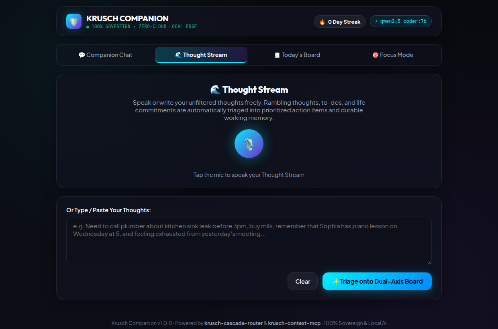

<p align="center">
  <h1 align="center">🛡️ Krusch Companion</h1>
  <p align="center">
    <strong>Sovereign Personal AI Assistant & Daily Companion</strong><br>
    <em>A 100% private, local-first companion (like Dot or Grok) for voice thought capture, prioritized daily focus, and durable working memory.</em>
  </p>
</p>

<p align="center">
  <a href="https://github.com/kruschdev/krusch-companion/blob/main/LICENSE"></a>
  
  <a href="https://github.com/kruschdev/krusch-cascade-router"></a>
  <a href="https://github.com/kruschdev/krusch-context-mcp"></a>
  <a href="https://github.com/kruschdev/krusch-agentic-mcp"></a>
  <a href="https://github.com/kruschdev/G-krusch"></a>
  <a href="https://github.com/kruschdev/krusch-companion/actions/workflows/ci.yml"></a>
  
</p>

---

## 💡 What It Does For You

**Krusch Companion** is a sovereign, local-first personal AI assistant and daily companion—a 100% private, user-owned alternative to **OpenClaw / Grokbot**, **Meta Muse**, or **OpenAI Dot**. Instead of surrendering your personal thoughts, daily schedule, and life notes to centralized cloud data centers, Companion runs on your own hardware—turning raw voice streams into clear daily priorities, executing **13 live external APIs, concierge reservations, Google Workspace extensions, and multi-step personal assistant actions** via the **Krusch Agentic Proxy (`<holodata>` Dual-Engine)**, maintaining durable working memory across conversations, and providing supportive morning briefings and evening reflections.

### 🔄 The Daily Loop

```
  ┌─────────────────┐       ┌─────────────────┐       ┌─────────────────┐       ┌─────────────────┐
  │ 1. Thought      │  ──►  │ 2. Priority     │  ──►  │ 3. Agentic      │  ──►  │ 4. Focus &      │
  │    Stream       │       │    Board        │       │    Proxy (<holo>│       │    Reflection   │
  │ Voice or text   │       │ 5-tier triage   │       │ 13 live APIs    │       │ Timer & wins    │
  └─────────────────┘       └─────────────────┘       └─────────────────┘       └─────────────────┘
```

1. **Thought Stream (Capture)**: Speak into the microphone or paste an unfiltered stream-of-consciousness thought stream.
2. **5-Tier Triage (Organize)**: An edge LLM (or OpenRouter specialist) cleans cognitive noise, extracts actionable commitments, ranks them against a 5-tier priority framework, and isolates durable life facts into working memory.
3. **Today's Board & Lifecycle (Execute)**: Tactile daily board highlighting the single most critical task, with automatic daily recurring habit seeding, 1-click **"↻ Roll Over Unfinished"** task migration from prior days, 1-click **"🧩 Steps"** task decomposition, gamified checkmarks, and streak tracking.
4. **Agentic Action Proxy & L0 Commands (Act)**:
   - **Instant `<15µs` L0 CPU Commands (`$0.00` Token Cost)**: `Add task`, `Complete task`, `Delete task`, `Show my tasks`, `Roll over unfinished tasks`, `Break down task into steps`, `Instead of X, remember that Y`, plus safe AST arithmetic.
   - **13-Tool `<holodata>` Dual-Engine Agentic Proxy + G-Krusch Google Workspace Extensions**: Enables local 7B/14B models (or OpenRouter 32B/72B specialists) to execute real APIs and multi-step chains with automatic upstream-to-downstream data piping.
5. **Focus Mode & Coach Briefings (Deep Work & Review)**: Fullscreen distraction-free timer with ambient progress ring, AI micro-nudges (`"Just do 3 minutes"`), morning focus alignment, and evening wins reflection.

---

## ⚡ The 13-Tool Agentic Proxy (`<holodata>` Dual-Engine) & G-Krusch Workspace

Standard 7B/14B local models often struggle with deeply nested OpenAI JSON tool schemas when 10+ tools are injected into the prompt at once. Krusch Companion solves this by embedding the **`<holodata>` Dual-Engine Cognitive Blueprint** (adapted from [`krusch-agentic-mcp`](https://github.com/kruschdev/krusch-agentic-mcp)):
1. **Intent-Scoped Tool Pruning (`<250` tokens)**: [`detectAgenticIntent()`](src/agent/agentic-proxy.js) prunes the tool catalog down to only the 1–3 tools relevant to the user's request before calling the LLM.
2. **Unified `<holodata>` Thinker + Flat Tool Array**: The model first reasons through parameter constraints inside `<holodata>...</holodata>` XML tags and then emits a flat JSON tool array (`[{"name": "...", "arguments": {...}}]`).
3. **Upstream-to-Downstream Live Data Piping**: When chaining multiple tools in one turn (e.g., `get_weather` ➔ `save_note` or `gkrusch_drive` ➔ `gkrusch_gmail`), [`executeAgenticProxyTurn()`](src/agent/agentic-proxy.js) automatically pipes live upstream API outputs directly into downstream notes, push notifications, Google Drive docs, or Gmail drafts.
4. **Deterministic Offline Fallback**: Even if your local LLM or Google OAuth is temporarily offline, [`inferFallbackToolCalls()`](src/agent/agentic-proxy.js) and sovereign local fallbacks ensure tasks, notes, and drafts are never lost.

### 🛠️ Complete 13-Tool Capability Matrix

| Category | Tool Name | What It Accomplishes | Example Natural-Language Prompt |
| :--- | :--- | :--- | :--- |
| **🍽️ Concierge & Reservations** | `concierge_reservation` | Looks up live venue details (address, phone, website, hours, email via OpenStreetMap), generates pre-filled 1-click **OpenTable**, **Resy**, and **Google Maps** booking links, drafts/sends a concierge reservation request via **G-Krusch Gmail**, and places a reservation hold on Today's Board. | *"Make a reservation at Canlis Seattle for 4 people on Friday at 7pm"* |
| **☁️ Google Drive & Docs** | `gkrusch_drive` | Hybrid semantic + FTS5 BM25 RAG search across Google Drive, Google Docs Markdown export, Drive file creation (`G-Krusch/output/`), and `agent.md` cloud steering (with automatic local `data/notes/` mirror). | *"Search my Google Drive for the Q4 Architecture Spec"* |
| **📅 Google Calendar** | `gkrusch_calendar` | Lists upcoming Google Calendar events or schedules new calendar meetings/appointments (with automatic fallback to Today's Priority Board if offline). | *"Schedule a meeting on Google Calendar titled Architecture Sync at 2026-10-14T15:00:00"* |
| **✉️ Gmail Extension** | `gkrusch_gmail` | Searches Gmail messages (`from:`, `is:unread`), creates RFC-2822 MIME drafts in Gmail, or sends emails (with local `data/notes/email-draft-*.md` fallback). | *"Draft an email to team@krusch.dev about the Q4 Spec"* |
| **🌤️ Live Weather** | `get_weather` | Live geocoding + current temperature, wind speed, precipitation probability, and daily highs/lows via Open-Meteo (zero API key required). | *"What's the weather in Seattle right now?"* |
| **🔎 Web Research** | `web_research` | Queries DuckDuckGo Instant Answer & Wikipedia REST summaries for factual lookups and topic briefs. | *"Research the history of the Pomodoro Technique"* |
| **📄 URL Digest** | `fetch_url_digest` | **SSRF-guarded** live web page reader—strips scripts/styles and extracts readable text while blocking localhost, LAN, and cloud metadata IPs. | *"Read and summarize https://example.com"* |
| **📝 Notes Write** | `save_note` | Creates or updates clean Markdown documents inside your sandboxed local vault (`data/notes/`). | *"Save a note titled Weekly Goals: Ship v2.0 & review priorities"* |
| **📂 Notes Read** | `list_notes` | Lists all saved Markdown notes in `data/notes/` or reads a specific note by title. | *"Show my saved notes"* |
| **🔔 Push Alerts** | `send_notification` | Dispatches real-time push notifications to your phone or desktop via `ntfy.sh` or a custom self-hosted webhook topic. | *"Send a push notification to my phone: Pick up groceries at 5pm"* |
| **🖥️ Host Telemetry** | `system_status` | Reports live host CPU load, RAM usage, uptime, SQLite WAL `PRAGMA integrity_check`, active memory count, and board completion streak. | *"Check system status and telemetry"* |
| **⚖️ Sovereign Law/Biz** | `sovereign_gateway_query` | Queries local **KruschLaw (`:8085`)** for statutory RAG / tenant defense or **KruschBiz (`:8086`)** for corporate contract graphs. | *"Search KruschLaw statutes for California security deposit return deadlines"* |
| **📋 Board & Memory** | `board_action` | Creates or completes tasks on Today's 5-Tier Priority Board or saves durable facts to Working Memory as part of a multi-step tool chain. | *"Check the weather in Seattle and add a task to go for a 3-mile run"* |

### 🎯 Example Multi-Step Workflows

* **Google Workspace Chain (`gkrusch_drive` ➔ `gkrusch_calendar` ➔ `gkrusch_gmail`)**:
  > *"Search my Google Drive for Q4 Architecture Spec, schedule an Architecture Sync on my Google Calendar, and draft an email to team@krusch.dev with the summary."*
  > ➜ **Tool 1 (`gkrusch_drive`)**: Runs hybrid semantic + BM25 search across your indexed Google Drive workspace.
  > ➜ **Tool 2 (`gkrusch_calendar`)**: Creates the event on Google Calendar (or falls back to Today's Priority Board if offline).
  > ➜ **Tool 3 (`gkrusch_gmail`)**: Automatically pipes the Google Drive RAG summary into a Gmail draft (with local Markdown mirror in `data/notes/`).

* **Weather + Note + Push Notification + Priority Board Chain**:
  > *"What is the weather in Seattle right now, save a note titled Run Forecast, and add a task to go for a 20-minute walk?"*
  > ➜ **Tool 1 (`get_weather`)**: Queries live Open-Meteo API (`60.8°F / 16°C — Overcast ☁️, Wind 1.9 mph, Precip 10%`).
  > ➜ **Tool 2 (`save_note`)**: Automatically pipes the live weather forecast into `data/notes/run-forecast.md`.
  > ➜ **Tool 3 (`board_action`)**: Creates **[Tier 4: Health & Self 💪] Go for a 20-minute walk** on Today's Board.

* **Voice/Text Thought Stream**:
  > *"I need to send the updated invoice to Alex, fix the door latch before tonight, schedule a dentist checkup for next Tuesday, and I kept forgetting to stretch today."*
  > ➜ **Extracted into Tasks**:
  > 1. `Send updated invoice to Alex` (Tier 5: Work & Mastery)
  > 2. `Fix door latch before tonight` (Tier 4: Health & Self / Environment)
  > 3. `Schedule dentist checkup for Tuesday` (Tier 4: Health & Self)
  > ➜ **Saved to Working Memory**: `Remember to take stretching breaks during desk work` (Category: `lesson`).

* **Instant L0 Task & Board Commands in Chat (`<15µs` CPU, `$0.00` LLM Cost)**:
  > *"Add task: Schedule dentist cleaning at 2pm"* ➜ Automatically inferred as **Tier 4 (Health & Self)** and added to Today's Board.
  > *"Complete task: dentist cleaning"* ➜ Marks the matching task completed on Today's Board and awards gamification points.
  > *"Break down 'Prepare quarterly taxes' into steps"* ➜ Decomposes the goal into 3 bite-sized (5–15 min) subtasks on Today's Board.
  > *"Roll over unfinished tasks"* ➜ Moves incomplete tasks from prior days onto Today's Board without duplicating recurring habits.

* **Working Memory with Fact Superseding**:
  > *"Instead of espresso, remember that I switched to green tea after lunch."*
  > ➜ Persisted in local SQLite (`companion_context`). The obsolete coffee memory is atomically marked `superseded_by` with full lineage, preventing prompt contradiction on future turns.

---

## 🚫 What It Is NOT

To be completely honest about scope and capabilities:

* **Not a multi-user SaaS**: Companion is a single-user executive co-pilot designed for personal sovereignty. There are no multi-tenant logins or shared organization workspaces.
* **Not zero-setup**: It requires running a local LLM runtime ([Ollama](https://ollama.com/)) on your machine or home server, or setting an OpenRouter API key for zero-GPU mode.

---

## 🖥️ User Interface Tour

The frontend is an installable Progressive Web App (PWA) built with React 19, Vite, and dark glassmorphism styling compliant with Apple HIG touch targets.

| 💬 Companion Chat | 🌊 Thought Stream |
|:---:|:---:|
|  |  |
| *Real-time L0/L1/L2/L3 routing badges, expandable `<holodata>` Agentic Proxy traces, and morning focus briefings.* | *Live HTML5 microphone waveform visualizer and stream-of-consciousness text input.* |

| 📋 Today's Board | 🎯 Focus Mode |
|:---:|:---:|
|  |  |
| *5-tier priority framework, 1-click task rollover & step decomposition, and streak counter.* | *Distraction-free single-task execution with ambient timer ring and hotkeys.* |

---

## 🚀 Quickstart

Krusch Companion supports two operating modes:
* **Option A: 100% Sovereign Local-First (Default)**: Uses local Ollama on your machine or home server. Zero LLM network egress.
* **Option B: Zero-GPU Cloud Connector (OpenRouter 3-Specialist Cascade)**: For laptops, cloud VPS, or devices without a discrete GPU. Uses [OpenRouter](https://openrouter.ai/) with enforced **Zero Data Retention** (`provider: { data_collection: "deny" }`) and dynamically routes across 3 specialized frontier models (`qwen-2.5-coder-32b-instruct`, `qwen-2.5-72b-instruct`, and `deepseek-chat-v3-0324`). Your database, notes vault, and working memory still remain 100% local in SQLite.

### Prerequisites

#### If running Option A (Local Ollama):
1. **Node.js**: `v22.0.0+`
2. **Local LLM Runtime**: [Ollama](https://ollama.com/) running locally:
   ```bash
   ollama pull qwen2.5-coder:7b
   ```
3. **Hardware Expectations**:
   * **GPU (Recommended)**: ~6–8 GB VRAM (RTX 2080 Ti, RTX 3060, Apple Silicon). ~30–50 tokens/sec.
   * **CPU (Usable)**: ~16 GB system RAM. ~5–10 tokens/sec.

#### If running Option B (OpenRouter Zero-GPU Specialist Cascade):
1. **Node.js**: `v22.0.0+`
2. **OpenRouter API Key**: Obtain from [openrouter.ai](https://openrouter.ai/keys). Defaults to `qwen/qwen-2.5-72b-instruct` with automatic dynamic cascade across `qwen/qwen-2.5-coder-32b-instruct` (for `<holodata>` tool calls) and `deepseek/deepseek-chat-v3-0324` (for deep reasoning).
3. **No GPU or Ollama required**! Runs on any low-power device.

### 📦 Ecosystem & Monorepo Dependencies

> [!NOTE]
> Krusch Companion is part of the Krusch homelab ecosystem. It references sibling packages via local file paths in `package.json`:
> - `@krusch/toolkit` (at `../../lib`)
> - `krusch-cascade-router` (at `../krusch-cascade-router`)
> - `g-krusch` (optional Google Workspace Extension service on `http://127.0.0.1:5446`)

To run Companion, ensure your directory layout matches the monorepo structure:

```
homelab/
├── lib/                         # Shared @krusch/toolkit utilities
└── projects/
    ├── krusch-cascade-router/   # Microsecond CPU Cascade Router
    ├── g-krusch/                # Optional Google Drive/Calendar/Gmail OAuth bridge (:5446)
    └── krusch-companion/        # This repository (:3004)
```

### Installation & Run

```bash
# 1. Clone within the homelab workspace
git clone https://github.com/kruschdev/krusch-companion.git
cd krusch-companion

# 2. Install backend and frontend dependencies
npm install
cd client && npm install && cd ..

# 3. Build the frontend client
cd client && npm run build && cd ..

# 4. Run automated tests (34 unit & integration tests across 5 suites)
npm test

# 5. Start the server
# Path A: Local Ollama (default)
npm start

# Path B: OpenRouter Zero-GPU 3-Specialist Cascade Mode
OPENROUTER_API_KEY="sk-or-v1-..." LLM_PROVIDER="openrouter" npm start
```

Visit **`http://localhost:3004`** in your browser, or install it as a PWA on your mobile device (iOS Safari: *Share → Add to Home Screen*; Android Chrome: *Install App*).

---

## 🏛️ System Architecture

Krusch Companion is built around the **Krusch Cascade Router**, the **`<holodata>` Dual-Engine Agentic Proxy**, the **KruschContext Engine**, and the **G-Krusch Google Workspace Bridge**:

```
                                 [ User Interaction ]
                        (Voice WebM / Text / Keyboard Hotkeys)
                                          │
                                          ▼
                      ┌───────────────────────────────────────┐
                      │     krusch-cascade-router (L0 Gate)   │
                      │       <15µs CPU Intent & Cost Gate    │
                      └───────────────────┬───────────────────┘
                                          │
         ┌────────────────────────────────┼────────────────────────────────┐
         ▼                                ▼                                ▼
   [ Tier 0: Direct CPU ]     [ <holodata> Agentic Proxy ]     [ Tier 1 / 2 / Cloud ]
   - Safe AST Arithmetic       - Intent-Scoped Tool Pruning     - Local: 7B Edge / 14B Swarm
   - Direct Task/Board/Memory  - 12 Live Tools + Chaining       - OpenRouter 3-Specialist
   - <15µs Latency ($0.00)     - G-Krusch Drive/Cal/Gmail         Dynamic Cascade (ZDR)
         │                                │                                │
         └────────────────────────────────┴────────────────────────────────┘
                                          │
                                          ▼
                      ┌───────────────────────────────────────┐
                      │          KruschContext Engine         │
                      │  - Working Memory (5 Closed Taxonomies│
                      │  - Temporal Fact Superseding & Decay  │
                      │  - Knowledge Boundary Gate (Pruning)  │
                      │  - SQLite WAL + data/notes/ Vault     │
                      └───────────────────────────────────────┘
```

### 1. Sub-15µs CPU Cascade Router & Dynamic Specialist Routing
* **L0 Deterministic Heuristic (`<15µs` CPU, `$0.00` Cost)**: Captures commands like `"Add task: ..."`, `"Complete task: ..."`, `"Show my tasks"`, `"Roll over unfinished tasks"`, `"Instead of X, remember that Y"`, or evaluates math expressions on CPU in microseconds with zero token cost.
* **L1 Local Edge (`Ollama`)**: Dispatches daily conversational queries and `<holodata>` tool calls to local Ollama (`qwen2.5-coder:7b`) with sub-second response times.
* **L2 Compute Swarm (`vLLM` / `Ollama 14B`)**: Transparently escalates heavy, multi-paragraph prompts to local network compute nodes with automatic fallback hedging.
* **OpenRouter 3-Specialist Dynamic Cascade (Zero-GPU Mode)**: When `LLM_PROVIDER="openrouter"` (or hybrid escalation is enabled), [`selectOpenRouterSpecialistModel()`](src/router/cascade-client.js) inspects each turn and dynamically selects the optimal Zero-Data-Retention (`data_collection: "deny"`) specialist model:

| Specialist Role | Selected OpenRouter Model | Live ZDR Benchmark Latency (2-Tool / 3-Tool Chain) | `<holodata>` Accuracy |
| :--- | :--- | :---: | :---: |
| **🛠️ Tool Calling, `<holodata>` Proxy & JSON Triage** | `qwen/qwen-2.5-coder-32b-instruct` | **`444ms` / `403ms`** | **100%** |
| **💬 Daily Companion, Coaching & Morning Briefings** *(Default)* | `qwen/qwen-2.5-72b-instruct` | **`544ms` / `1135ms`** | **100%** |
| **🧠 Deep Multi-Step Reasoning & Architecture Analysis** | `deepseek/deepseek-chat-v3-0324` | **`1788ms` / `1314ms`** | **100%** |

### 2. KruschContext Working Memory & Temporal Superseding
Unlike naive vector memory that hoards contradictory entries:
* **5-Category Closed Taxonomy**:
  * `decision`: Firm commitments or choices.
  * `invariant`: Non-negotiable rules, constraints, or health boundaries.
  * `bug`: Friction points, habits to break, or personal pitfalls.
  * `lesson`: Tactical insights or routines learned.
  * `blocker`: Active external dependencies or stressors.
* **Temporal Superseding (`MemoryInvalidationEngine`)**: When a habit changes, the outdated record is marked `superseded_by`, preserving lineage without corrupting current context.
* **30-Day Decay Review**: Stale facts older than 30 days are automatically surfaced for hygiene review.

### 3. Knowledge Boundary Gating
Injecting long-term personal context into mathematically or syntactically self-contained tasks (e.g. arithmetic, simple timers) can introduce cognitive interference (*"Memory Is Not Always Needed"*, arXiv: 2608.23982). Companion gates memory retrieval, suppressing irrelevant backstory when executing closed-world tasks.

### 4. Enterprise Hardening, SSRF Shield & Zero-Lock Backups
* **AST Recursive-Descent Evaluator**: Replaces dangerous `eval` and `Function` calls with a pure AST arithmetic tokenizer supporting powers, decimals, and parentheses while safely rejecting code injection and division-by-zero.
* **SSRF Network Guard (`isSafeExternalUrl`)**: Blocks loopback (`127.0.0.1`, `localhost`), RFC1918 private LAN ranges, and cloud metadata IPs (`169.254.169.254`) on external URL digest requests.
* **Prompt Injection Shield**: Integrated `sanitizeAgentMessage` from `@krusch/toolkit/trajectory-guard` filters ChatML breakouts, Llama tags, and prompt injection patterns (*arXiv: 2608.10218*).
* **Sovereign Backup API**: Creates zero-lock SQLite snapshots in milliseconds using `VACUUM INTO` (`POST /api/backup`).

---

## ⚖️ Why This Exists: The Big Tech Tradeoff

| Dimension | OpenClaw / Grokbot / Meta Muse / OpenAI Dot | **Krusch Companion** |
|:---|:---|:---|
| **Data Ownership** | Centralized cloud data centers | **100% Local SQLite WAL & `data/notes/` on your hardware** |
| **Privacy Policy** | Chats mined for training & profiling | **Zero telemetry; enforced `data_collection: "deny"` in cloud mode** |
| **Inference Cost** | $20+/month subscription or ad-tracking | **$0.00 / Zero-token cost** on local Ollama (or pennies/mo via OpenRouter) |
| **Offline Operation** | ❌ Fails without active internet connection | ✅ **Fully operational offline on local network** |
| **Live Action & Tool Execution** | Cloud-locked proprietary plugins | **12-Tool `<holodata>` Agentic Proxy** (Weather, Web, Notes, Alerts, Telemetry, Legal/Biz RAG) |
| **Google Workspace Integration** | Full cloud read access to your account | **Sovereign `G-Krusch` Bridge** (Drive Hybrid RAG, Docs, Calendar, Gmail + local offline fallbacks) |
| **Task Routing** | Monolithic cloud roundtrips for all queries | **Cascade Router**: L0 Heuristic (<15µs) + L1 Edge + L2/Specialist Cascade |
| **Context Hygiene** | Unbounded vector RAG (prone to hallucinations) | **KruschContext**: 5 closed taxonomies + temporal superseding |
| **Actionable Priority Triage**| Conversational chitchat and journaling | **Thought Stream Engine**: Rambling speech triaged into 5-tier board |

---

## 🛡️ Privacy Deep-Dive: Local Ollama vs. OpenRouter

For most developers and privacy-conscious users, **OpenRouter is the most practical entry point** because running local 24/7 GPU hardware involves real operational overhead. However, switching from local inference to an API proxy introduces architectural differences that every privacy-minded user should understand.

### Comparative Threat Model

| Dimension | Option A: Local Ollama (Sovereign Default) | Option B: OpenRouter Cloud Connector |
|:---|:---|:---|
| **Hardware Barrier** | Requires 6–8 GB VRAM or 16 GB system RAM | **Zero GPU required** (MacBook Air, Raspberry Pi, VPS) |
| **Physical Perimeter**| 100% on `localhost` (`127.0.0.1`) or LAN | Ephemeral prompt text travels over TLS to OpenRouter |
| **Database & History**| **100% Local SQLite WAL** (`data/companion.db`) | **100% Local SQLite WAL** (database is never uploaded) |
| **Long-term Memory** | Stays on local disk | Stays on local disk |
| **L0 Heuristics (Math/Tasks)**| Evaluated on local CPU in <15µs | Evaluated on local CPU in <15µs (never hits the network) |
| **Intermediary Trust** | None (self-hosted bare metal) | OpenRouter proxy + Upstream Model Provider |
| **Model Training Risk**| Physically impossible (weights run read-only) | Prevented via enforced `provider: { data_collection: "deny" }` |
| **Logging / Retention**| Zero external logs | Ephemeral transit; upstream hosts may retain 30-day abuse logs |

### The 5 Key Privacy Considerations

1. **Transit vs. Storage**:
   * **What never leaves your machine**: Your task lists, 5-tier priority board, completed task timestamps, streak counts, local Markdown vault (`data/notes/`), and KruschContext memory store stay **strictly on your local drive**.
   * **What travels in transit**: During an active turn, only the prompt text and immediate session context travel over TLS to OpenRouter for inference.
2. **The Intimate Nature of Personal Journaling & Daily Thoughts**:
   * A personal AI companion is uniquely intimate. Stream-of-consciousness Thought Streams often mention medical prescriptions (*"refill medication"*), therapy appointments, relationship friction, or sensitive financial notes.
   * If you are dumping highly confidential personal or medical data, **Option A (Local Ollama)** guarantees that not a single byte leaves your physical machine.
3. **The Two-Hop Trust Chain**:
   * Calling OpenRouter involves two hops: `[Your Companion] ──► [OpenRouter Proxy] ──► [Upstream Host (e.g. Together, DeepInfra, Fireworks, Azure)]`.
   * OpenRouter sees the plaintext request to count billing tokens, and forwards it to the model host.
4. **Enforced Zero Data Retention (`data_collection: "deny"`)**:
   * Krusch Companion automatically injects `provider: { data_collection: "deny" }` on every OpenRouter request. This parameter instructs OpenRouter to **strictly reject upstream providers that log prompts for model training**.
5. **Paid Endpoints vs. Free Endpoints**:
   * **Paid models** (such as `qwen/qwen-2.5-72b-instruct`, `qwen/qwen-2.5-coder-32b-instruct`, and `deepseek/deepseek-chat-v3-0324` at pennies per month) operate under commercial API privacy protections and support strict Zero Data Retention (`data_collection: "deny"`).
   * **Free models** (endpoints with the `:free` suffix) often explicitly trade free compute in exchange for allowing upstream providers to log prompts for safety tuning.
   * **Recommendation**: If using OpenRouter, stick to paid models and keep `OPENROUTER_ZDR=true`. For sensitive journaling, use **Hybrid Mode** or switch to local Ollama.

---

## ⚙️ Configuration (`config.json`)

The server configuration is located in `config.json` at the project root (and overridable via environment variables):

| Key | Default | Environment Var | Description |
|:---|:---|:---|:---|
| `app.port` | `3004` | `PORT` | Local port for Express API server and static client. |
| `app.host` | `"0.0.0.0"` | `HOST` | Host binding (`0.0.0.0` allows LAN access from phone/laptop). |
| `cascade.provider` | `"ollama"` | `LLM_PROVIDER` | Active LLM driver: `"ollama"` (local GPU), `"openrouter"` (zero-GPU cloud), or `"hybrid"`. |
| `cascade.allowCloudEscalation` | `false` | `ALLOW_CLOUD_ESCALATION` | When `false`, requests never leave local hardware. If `true` or `"hybrid"`, falls back to OpenRouter if Ollama fails. |
| `cascade.openrouterApiKey` | `""` | `OPENROUTER_API_KEY` | OpenRouter API key for zero-GPU mode or cloud fallback. |
| `cascade.openrouterModel` | `"qwen/qwen-2.5-72b-instruct"` | `OPENROUTER_MODEL` | Default OpenRouter model (automatically cascades across `qwen-2.5-coder-32b-instruct` for `<holodata>` tools, `qwen-2.5-72b-instruct` for coaching, and `deepseek-chat-v3-0324` for deep reasoning). |
| `cascade.openrouterZeroDataRetention`| `true` | `OPENROUTER_ZDR` | **Privacy Shield**: Injects `provider: { data_collection: "deny" }` to prevent model training and prompt retention. |
| `cascade.l0HeuristicEnabled` | `true` | — | Enables sub-15µs CPU routing for math and direct memory storage (always local). |
| `cascade.edgeModel` | `"qwen2.5-coder:7b"` | `EDGE_MODEL` | Name of local Ollama model for fast daily tasks. |
| `cascade.swarmModel` | `"qwen2.5-coder:14b"`| `SWARM_MODEL` | Name of compute server model for deep reasoning. |
| `cascade.ollamaUrl` | `"http://127.0.0.1:11434"` | `OLLAMA_HOST` | URL of local Ollama instance. |
| `cascade.swarmUrl` | `"http://127.0.0.1:8000/v1"` | `SWARM_VLLM_URL` | URL of local network compute node or secondary vLLM server. |
| — | `"http://127.0.0.1:5446"` | `G_KRUSCH_URL` | URL of local G-Krusch Google Workspace Extension server (Drive RAG, Calendar, Gmail). |
| `db.path` | `"./data/companion.db"` | `DB_PATH` | Path to SQLite WAL database file. |
| `context.decayDays` | `30` | `CONTEXT_DECAY_DAYS` | Age threshold in days before memories are flagged for decay review. |

> ### 🔒 OpenRouter Privacy & Sovereignty Guarantee
> When operating in OpenRouter mode:
> 1. **Zero Data Retention Enforced**: Krusch Companion transmits `provider: { data_collection: "deny" }` on every request, instructing OpenRouter to route exclusively to providers that do not log prompts or train on user inputs.
> 2. **Sovereign Local Storage**: Only the prompt for the active turn travels over TLS to OpenRouter. **100% of your persistent tasks, 5-tier boards, streak counts, and KruschContext working memory remain stored exclusively in local SQLite on your own drive.**
> 3. **L0 Direct Heuristic Remains 100% Local**: Deterministic arithmetic and direct memory parsing continue running on your local CPU in <15µs with zero network calls.

---

## 📡 Complete REST API Reference

| Method | Endpoint | Description |
| :--- | :--- | :--- |
| `GET` | `/api/health` | Service status, connected local models, and privacy gate configuration. |
| `GET` | `/api/priorities` | Retrieves the 5-tier priority framework definitions and colors. |
| `GET` | `/api/tasks` | Retrieves tasks for date (`?date=YYYY-MM-DD`, defaults to today) and auto-seeds recurring habits. |
| `POST` | `/api/tasks` | Creates a new task (`{ title, priority_id, notes, recurring, energy_level, date }`). |
| `POST` | `/api/tasks/rollover` | Rolls over unfinished tasks from prior days onto Today's Priority Board without duplicating recurring habits. |
| `POST` | `/api/tasks/:id/breakdown` | Decomposes a complex task into 3 concrete, low-friction subtasks on Today's Board. |
| `PATCH` | `/api/tasks/:id/complete` | Toggles task completion and updates gamification points. |
| `DELETE`| `/api/tasks/:id` | Deletes a task by ID. |
| `GET` | `/api/streak` | Retrieves continuous task completion streak data. |
| `GET` | `/api/gamify/today` | Retrieves today's gamification points and opt-in status. |
| `POST` | `/api/gamify/opt-in` | Updates gamification opt-in status (`{ optedIn: boolean }`). |
| `POST` | `/api/companion/chat` | Main conversational & `<holodata>` Agentic Proxy endpoint routed via Cascade Router (`{ prompt, history, sessionId }`). |
| `GET` | `/api/companion/tools` | Lists all 12 registered Agentic Proxy (`<holodata>` Dual-Engine) tools and parameter schemas (aliases `/api/agent/tools`). |
| `POST` | `/api/companion/action` | Directly executes a sandboxed Agentic Proxy tool (`{ tool, arguments }`, aliases `/api/agent/execute`). |
| `POST` | `/api/companion/stream` | Ingests unformatted Thought Stream text and triages into 5-tier tasks and memories (aliases `/api/companion/dump`). |
| `POST` | `/api/companion/voice` | Accepts multipart `audio` (WebM/WAV) -> Whisper STT -> Thought Stream pipeline. |
| `GET` | `/api/coach/focus` | Retrieves today's active morning focus briefing. |
| `POST` | `/api/coach/focus` | Synthesizes a new morning focus briefing from tasks and working memory. |
| `POST` | `/api/coach/nudge` | Generates a 1-sentence focus micro-nudge for the current task. |
| `POST` | `/api/coach/reflect` | Synthesizes an evening reflection celebrating wins. |
| `GET` | `/api/context` | Retrieves active working memory nuggets and compiled state briefing (`?category=...`). |
| `POST` | `/api/context` | Persists a new memory nugget (`{ category, content, key, confidence }`). |
| `POST` | `/api/context/:id/supersede`| Invalidates an old memory record and links an updated fact (`{ newContent, reason }`). |
| `GET` | `/api/context/decay` | Lists memories older than N days (`?days=30`) for hygiene review. |
| `POST` | `/api/backup` | Creates an atomic zero-lock SQLite backup snapshot via `VACUUM INTO`. |
| `GET` | `/api/system/integrity` | Executes SQLite `PRAGMA integrity_check`. |

---

## 🐳 Docker Deployment

A multi-stage `Dockerfile` and `docker-compose.yml` are provided for home server deployment:

```bash
# Start containerized service in background
docker compose up -d

# View live container logs
docker compose logs -f

# Check container health
docker compose ps
```

---

## 🔧 Troubleshooting

| Symptom | Probable Cause | Resolution |
|:---|:---|:---|
| `fetch failed: ECONNREFUSED 127.0.0.1:11434` | Ollama is not running. | Run `ollama serve`, or switch to OpenRouter mode (`LLM_PROVIDER="openrouter"`). |
| `Ollama error: model 'qwen2.5-coder:7b' not found` | Recommended model has not been pulled. | Execute `ollama pull qwen2.5-coder:7b`. |
| `G-Krusch Google Drive/Calendar/Gmail returned: Not authenticated` | Google OAuth not connected on `g-krusch` (`:5446`). | Connect Google OAuth at `http://localhost:5446/auth/google` (while disconnected, Companion automatically falls back to saving notes/drafts in `data/notes/` and tasks on Today's Board). |
| `Cannot find module '@krusch/toolkit'` | Monorepo layout path mismatch. | Ensure sibling directories exist (`../../lib` and `../krusch-cascade-router`). |
| `No audible speech detected` on voice upload | Microphone muted or Whisper server down. | Verify microphone permissions in browser or check Whisper service on port 9000. |
| Tasks not persisting across container restarts | Docker volume not mounted. | Ensure `./data` is mounted to `/app/data` in `docker-compose.yml`. |

---

## 📌 Project Status & Known Limitations

* **Current Stage**: Active daily driver in the Krusch homelab fleet (`34/34` unit & integration tests passing). Single-user architecture; code integrates with the `@krusch/toolkit`, `krusch-cascade-router`, and `g-krusch` monorepo ecosystem.
* **Single User**: No authentication or multi-tenant user segregation out of the box (intended for private home networks or Tailscale mesh).
* **Hardware Sensitivity**: Local speech-to-text and Ollama LLM inference response times depend directly on host GPU/CPU capabilities (or use OpenRouter Zero-GPU mode for `<500ms` cloud specialist execution).

---

## 🔗 Related Projects

* [`krusch-cascade-router`](https://github.com/kruschdev/krusch-cascade-router): Sub-15µs CPU routing substrate with AST arithmetic evaluation and fallback hedging.
* [`krusch-context-mcp`](https://github.com/kruschdev/krusch-context-mcp): Model Context Protocol server providing working memory, invariant steering, and fact superseding.
* [`krusch-agentic-mcp`](https://github.com/kruschdev/krusch-agentic-mcp): Dual-Engine `<holodata>` cognitive blueprint & tool execution proxy for 7B/14B models.
* [`G-krusch`](https://github.com/kruschdev/G-krusch): Sovereign Google Workspace Extension bridge (Google Drive Hybrid RAG, Google Docs, Google Calendar, and Gmail).

---

## 📄 License

MIT © [kruschdev](https://github.com/kruschdev). Part of the Krusch Homelab Sovereign AI Ecosystem.
